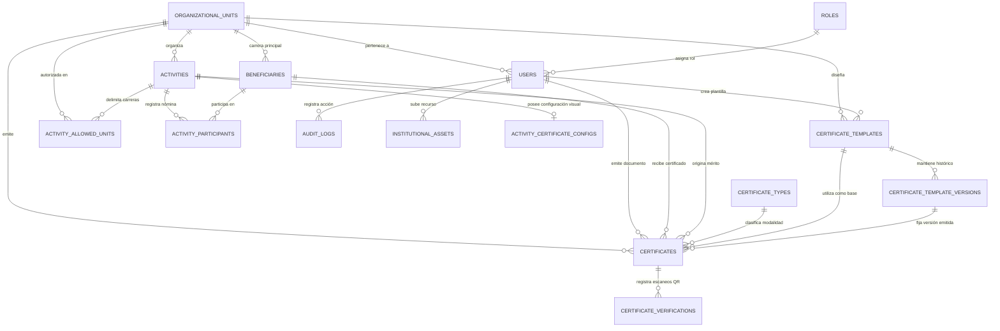

# Documentación Técnica, Arquitectura y Guía de Soporte

**Sistema:** Plataforma Web de Gestión, Generación, Diseño, Emisión y Verificación de Certificados Académicos con Código QR  
**Entorno Institucional:** Facultad de Tecnología — Universidad Mayor de San Andrés (UMSA)  
**Versión:** 2.5.0 (Arquitectura Multirrol, Multitenancy Facultativo y Motor de Resoluciones)  
**Fecha:** Noviembre 2026  

---

## 📌 Tabla de Contenidos
1. [Visión General de la Arquitectura](#1-visión-general-de-la-arquitectura)
2. [Stack Tecnológico y Dependencias](#2-stack-tecnológico-y-dependencias)
3. [Modelo de Base de Datos y Diagrama ERD](#3-modelo-de-base-de-datos-y-diagrama-erd)
4. [Capa de Servicios y Lógica de Negocio](#4-capa-de-servicios-y-lógica-de-negocio)
5. [Arquitectura Multirrol y Multitenancy Facultativo](#5-arquitectura-multirrol-y-multitenancy-facultativo)
6. [Motor de Resoluciones Facultativas y Reglas de Audiencia](#6-motor-de-resoluciones-facultativas-y-reglas-de-audiencia)
7. [Regla Ética de Calificaciones y Aprobación Obligatoria (>= 51 pts)](#7-regla-ética-de-calificaciones-y-aprobación-obligatoria--51-pts)
8. [Padrón Único y Portafolio Académico 360° del Estudiante](#8-padrón-único-y-portafolio-académico-360-del-estudiante)
9. [Motor de Diseño, Variables Dinámicas y Plantillas](#9-motor-de-diseño-variables-dinámicas-y-plantillas)
10. [Seguridad, Criptografía e Inmutabilidad Documental](#10-seguridad-criptografía-e-inmutabilidad-documental)
11. [Estructura del Proyecto y Mapeo de Archivos](#11-estructura-del-proyecto-y-mapeo-de-archivos)
12. [Suite de Pruebas Automatizadas](#12-suite-de-pruebas-automatizadas)
13. [Guía de Despliegue y Ejecución en Laragon / Windows](#13-guía-de-despliegue-y-ejecución-en-laragon--windows)
14. [Operaciones, Mantenimiento y Respaldos](#14-operaciones-mantenimiento-y-respaldos)

---

## 1. Visión General de la Arquitectura

El sistema está construido bajo una arquitectura desacoplada en capas basada en el patrón **Modelo-Vista-Controlador (MVC)**, reforzada con una **Capa de Servicios (Service Layer)** y una **Capa de Aislamiento Organizacional (Multi-Unit Tenancy Layer)** que permite operar a toda la Facultad de Tecnología de la UMSA manteniendo el aislamiento seguro entre sus 9 carreras y unidades administrativas.

```
┌─────────────────────────────────────────────────────────────────────────┐
│                        CAPA DE PRESENTACIÓN (UI)                         │
│  Blade Templates + Tailwind CSS v4 + Alpine.js                          │
│  - Portafolio Académico 360° del Beneficiario                           │
│  - Catálogo y Diseñador Visual de Plantillas (WYSIWYG con Drag & Drop)   │
│  - Módulo Administrativo de Carreras y Departamentos (/carreras-depto)   │
│  - Fichas de Emisión Individual, Nómina Roster y Portal QR Público      │
└────────────────────────────────────┬────────────────────────────────────┘
                                     │ HTTP Requests / Form Actions
┌────────────────────────────────────▼────────────────────────────────────┐
│                  CAPA DE SEGURIDAD & MIDDLEWARE (RBAC)                  │
│  - Authenticate: Protección de sesión web                               │
│  - EnsureUserIsAdmin: Restricción al Super Administrador (Cómputo)      │
│  - EnsureCanAccessReports: Permiso a Admin y Jefe; Bloqueo a Secretaria │
│  - EnsureCanManageTemplates: Acceso a Admin, Jefe y Secretaria          │
│  - Scope Enforcement: Aislamiento estricto de carrera en controladores  │
└────────────────────────────────────┬────────────────────────────────────┘
                                     │ Inyección de Dependencias
┌────────────────────────────────────▼────────────────────────────────────┐
│                        CAPA DE SERVICIOS (SERVICES)                     │
│  - CertificateService: Emisión criptográfica, vigencias y hashes SHA-256│
│  - BeneficiaryImportService: Nóminas Excel/CSV, detección de aprobados, │
│    exclusión de reprobados (<51 pts) y validación de resoluciones       │
│  - TemplateEngineService: Esquemas JSON, Variables dinámicas, Firmas    │
│  - CertificateSnapshotService: Congelación documental inmutable         │
│  - CertificatePdfService: Compilación DomPDF A4 Horizontal/Vertical     │
│  - QRCodeService: Generación SVG vectorial Base64                       │
│  - AssetManagerService: Almacenamiento tipado de logos, sellos y firmas │
│  - AuditLog: Trazabilidad administrativa forense                        │
└────────────────────────────────────┬────────────────────────────────────┘
                                     │ Eloquent ORM
┌────────────────────────────────────▼────────────────────────────────────┐
│                     CAPA DE PERSISTENCIA Y ARCHIVOS                     │
│  MySQL 8.x (InnoDB, UTF-8 MB4) + Local Storage (PDFs, Snapshots, Assets)│
└─────────────────────────────────────────────────────────────────────────┘
```

---

## 2. Stack Tecnológico y Dependencias

| Componente | Tecnología | Versión | Propósito |
| :--- | :--- | :--- | :--- |
| **Lenguaje Backend** | PHP | 8.3+ / 8.5 | Motor de ejecución del servidor en Laragon sobre Windows |
| **Framework Backend** | Laravel | 13.x | Arquitectura modular con MVC, Eloquent ORM y Blade Engine |
| **Base de Datos** | MySQL | 8.0+ / 8.4+ | Base de datos relacional con claves foráneas e integridad referencial |
| **Motor de Estilos** | Tailwind CSS | 4.x | Sistema de diseño institucional sobrio, moderno y adaptativo |
| **Interactividad Frontend** | Alpine.js | 3.14+ | Reactividad en el diseñador visual, modales y previsualizaciones |
| **Generador PDF** | `barryvdh/laravel-dompdf` | 3.1+ | Compilación de plantillas HTML/CSS vectoriales a PDF A4 |
| **Generador QR** | `simplesoftwareio/simple-qrcode` | 4.2+ | Generación de códigos QR vectoriales en formato SVG Base64 |
| **Bundler Frontend** | Vite | 8.x | Compilación y empaquetado de assets CSS y JavaScript |
| **Suite de Pruebas** | PHPUnit | 12.x | Pruebas de integración multitenant, roles y validación de notas |

---

## 3. Modelo de Base de Datos y Diagrama ERD

### 3.1 Diagrama Entidad-Relación (Mermaid)



---

## 4. Capa de Servicios y Lógica de Negocio

El sistema centraliza su lógica en servicios especializados ubicados en `app/Services/`:

1. **`CertificateService`**:
   - Coordina la emisión de certificados individuales y en lote.
   - Aplica la validación de unidad activa: si la carrera está desactivada, bloquea la emisión.
   - Aplica la validación de resolución y carrera autorizada: invoca `Activity::isCareerAllowed()`.
   - Resuelve esquemas de vigencia (*permanente* vs *temporal con expiración*).
   - Genera el código correlativo oficial y el token criptográfico UUID v4.
   - Invoca a `CertificateSnapshotService` para sellar inmutablemente el certificado y genera su hash SHA-256.

2. **`BeneficiaryImportService`**:
   - Procesa archivos `.xlsx` y `.csv` de beneficiarios o nóminas de eventos.
   - Realiza mapeo heurístico inteligente de columnas (`ci`, `nombres`, `apellidos`, `nota`, `carrera`, etc.).
   - Aplica la regla ética de notas: detecta reprobados (< 51 pts) o estudiantes sin calificación, excluyéndolos de la emisión.
   - Comprueba la elegibilidad de carrera según la resolución del evento, marcando a los no permitidos como `observados` (`career_eligible = false`).

3. **`TemplateEngineService`**:
   - Administra los esquemas JSON de diseño (`design_schema`) de las plantillas.
   - Maneja elementos tipados: textos institucionales, bloques de firmas oficiales, códigos QR, líneas divisorias e imágenes institucionales.
   - Procesa e interpola el diccionario de variables dinámicas (`{{beneficiario.nombre}}`, `{{certificado.puntaje}}`, `{{actividad.horas}}`, etc.).

4. **`CertificateSnapshotService`**:
   - Garantiza la **Regla 40 de Inmutabilidad Documental**: genera un snapshot JSON autosuficiente que congela nombres, textos resueltos, firmas, sellos, notas y diseño exacto al momento de emitir.

5. **`CertificatePdfService`**:
   - Transforma el snapshot inmutable a PDF vectorial de alta resolución en formato A4 (horizontal o vertical) mediante DomPDF.

6. **`QRCodeService`**:
   - Genera códigos QR vectoriales en formato SVG Base64 con nivel de corrección de error de alta densidad para escaneo instantáneo.

---

## 5. Arquitectura Multirrol y Multitenancy Facultativo

### 5.1 Matriz de Roles y Capacidades

| Módulo / Funcionalidad | 👑 Super Admin (Cómputo) | 🎓 Jefe de Carrera | 💼 Secretaria | ⚙️ Operador |
| :--- | :---: | :---: | :---: | :---: |
| **Gestión de Carreras y Deptos.** | ✅ (Total) | ❌ (403 Forbidden) | ❌ (403 Forbidden) | ❌ |
| **Gestión de Usuarios y Cuentas** | ✅ (Crear y asignar) | ❌ | ❌ | ❌ |
| **Dashboard y Estadísticas** | ✅ (Global + Filtro) | ✅ (Solo su Carrera) | ✅ (Solo su Carrera) | ✅ (Global) |
| **Actividades Académicas** | ✅ (Ver y crear todas) | ✅ (Solo su Carrera) | ✅ (Solo su Carrera) | ✅ |
| **Certificados Institucionales** | ✅ (Ver y auditar todos) | ✅ (Solo su Carrera) | ✅ (Solo su Carrera) | ✅ |
| **Padrón de Beneficiarios** | ✅ (Padrón Único) | ✅ (Portafolio 360°) | ✅ (Portafolio 360°) | ✅ |
| **Diseñador de Plantillas** | ✅ (Globales y locales) | ✅ (De su Carrera) | ✅ (De su Carrera) | ❌ (Solo lectura) |
| **Módulo de Reportes Estadísticos** | ✅ (Global + Filtro) | ✅ (De su Carrera) | ❌ (403 Forbidden) | ❌ |
| **Recursos (Firmas/Logos)** | ✅ (Biblioteca central) | ✅ (De su Carrera) | ✅ (De su Carrera) | ❌ |

### 5.2 Aislamiento por Unidad (`User::isUnitScoped()`)

En los controladores del sistema, la separación de datos se aplica de manera automática:
- Si el usuario tiene rol `jefe_carrera` o `secretaria`, `isUnitScoped()` retorna `true`.
- Las consultas a `activities`, `certificates` y `templates` se restringen automáticamente por `where('organizational_unit_id', $user->organizational_unit_id)`.
- Si un usuario scoped intenta abrir o modificar una actividad de otra carrera (`$activity->organizational_unit_id !== $user->organizational_unit_id`), el controlador aborta con **HTTP 403 Forbidden**.

### 5.3 Carreras Oficiales Registradas de la Facultad de Tecnología

El seeder oficial [`OrganizationalUnitSeeder`](file:///c:/Users/WINDOWS/OneDrive/Escritorio/inf-2026/sistema-certificado/database/seeders/OrganizationalUnitSeeder.php) precarga las 9 carreras oficiales de la Facultad:
1. **Carrera de Aeronáutica** (`AER`)
2. **Carrera de Construcciones Civiles** (`CIV`)
3. **Carrera de Electricidad Industrial** (`ELE`)
4. **Carrera de Electrónica y Telecomunicaciones** (`ELT`)
5. **Carrera de Electromecánica Industrial** (`ELM`)
6. **Carrera de Geodesia, Topografía y Geomática** (`TOP`)
7. **Carrera de Mecánica Automotriz** (`AUT`)
8. **Carrera de Mecánica Industrial** (`MEC`)
9. **Carrera de Química Industrial** (`QUI`)
junto a las unidades administrativas:
- **Vicedecanato y Facultad de Tecnología** (`VICEDECANATO`)
- **Departamento de Cómputo y Sistemas** (`COMPUTO`)
- **Decanato de la Facultad de Tecnología** (`DECANATO`)

---

## 6. Motor de Resoluciones Facultativas y Reglas de Audiencia

Para resguardar el marco reglamentario universitario, cada actividad académica cuenta con dos atributos de control:
- `resolution_number`: Número de Resolución Facultativa que respalda el evento (ej.: *RF-045/2026*).
- `target_audience_mode`: Modo de delimitación de audiencia:
  1. `own_unit` (*Propia Carrera/Unidad*): Solo los estudiantes matriculados en la carrera organizadora pueden recibir certificación.
  2. `all_faculty` (*Toda la Facultad*): Abierto a estudiantes de cualquiera de las 9 carreras (típico de eventos de Vicedecanato o Cómputo).
  3. `specific_units` (*Carreras Específicas por Resolución*): Permite seleccionar mediante la relación `allowedUnits` qué carreras participan conjuntamente (ejemplo: Simposio conjunto de Química y Mecánica).

### Lógica de Validación: `Activity::isCareerAllowed(?int $unitId): bool`
```php
public function isCareerAllowed(?int $unitId): bool
{
    // Si la actividad no tiene asignada una carrera organizadora o está configurada para toda la facultad
    if (empty($this->organizational_unit_id) || $this->target_audience_mode === self::AUDIENCE_ALL_FACULTY) {
        return true;
    }

    if ($unitId === null) {
        return false;
    }

    if ($this->target_audience_mode === self::AUDIENCE_OWN_UNIT) {
        return $this->organizational_unit_id === $unitId;
    }

    if ($this->target_audience_mode === self::AUDIENCE_SPECIFIC_UNITS) {
        if ($this->organizational_unit_id === $unitId) {
            return true;
        }

        return $this->allowedUnits()->where('organizational_units.id', $unitId)->exists();
    }

    return true;
}
```

Si se intenta inscribir o importar a un estudiante de una carrera no habilitada por la resolución, el sistema lo marca automáticamente como `status = 'observado'`, `career_eligible = false` y `ineligibility_reason = 'Carrera no autorizada (según Resolución ...)'`, **impidiendo la emisión de su certificado**.

---

## 7. Regla Ética de Calificaciones y Aprobación Obligatoria (>= 51 pts)

Para los tipos de certificado que conllevan evaluación académica (`has_score = true`, ej.: *Certificado de Aprobación*):
1. La nota mínima reglamentaria es de **51.0 puntos** (o la configurada en `min_passing_score`).
2. En la importación masiva de nóminas o inscripción de participantes:
   - Calificación $\ge 51.0$ $\rightarrow$ Clasificado como `inscrito` o `aprobado` (Habilitado para certificado).
   - Calificación $< 51.0$ $\rightarrow$ Clasificado como `reprobado` (No se le emite certificado).
   - Sin calificación registrada $\rightarrow$ Clasificado como `observado` (No se le emite certificado).
3. Tanto en la emisión por nómina (`issueToRoster`) como en lote (`batchIssue`), el sistema **filtra y omite automáticamente a estudiantes reprobados y sin nota**, emitiendo un reporte con el desglose exacto de certificados emitidos y estudiantes omitidos.

---

## 8. Padrón Único y Portafolio Académico 360° del Estudiante

El sistema mantiene un **Padrón Único de Beneficiarios** consolidado por Número de Documento (C.I.):
- Un estudiante de Química Industrial tiene un único perfil en el sistema.
- Si el estudiante aprueba un taller en su propia carrera y posteriormente asiste a un seminario de Vicedecanato o un congreso inter-carrera, todos los certificados se vinculan a su mismo expediente.
- En la vista [`beneficiaries/show.blade.php`](file:///c:/Users/WINDOWS/OneDrive/Escritorio/inf-2026/sistema-certificado/resources/views/beneficiaries/show.blade.php), se presenta el **Portafolio Académico 360°**, donde cada certificado se identifica mediante insignias claras:
  - 🏷️ **Emitido por su propia carrera** (ej. Química Industrial).
  - 🏛️ **Emitido a nivel facultativo** (Vicedecanato de Tecnología).
  - 📜 **Emitido por resolución inter-carrera**.

---

## 9. Motor de Diseño, Variables Dinámicas y Plantillas

### 9.1 Diseñador Visual WYSIWYG
El diseñador visual (`templates/designer.blade.php`) permite maquetar certificados A4 interactivos con arrastre de elementos porcentuales, ajuste fino con flechas de teclado, panel de capas e inspector de estilos en tiempo real.

### 9.2 Diccionario de Variables Interpolables
Los textos institucionales admiten etiquetas dinámicas que se sustituyen al momento de la emisión o previsualización:

| Variable | Descripción | Ejemplo de Salida |
| :--- | :--- | :--- |
| `{{beneficiario.nombre}}` | Nombre completo del estudiante o docente | Juan Pérez Gómez |
| `{{beneficiario.documento}}`| Documento de identidad | CI 8345291 LP |
| `{{beneficiario.carrera}}`  | Carrera del estudiante | Carrera de Química Industrial |
| `{{actividad.nombre}}`      | Título oficial del evento | Simposio Internacional de Automatización |
| `{{actividad.tipo}}`        | Tipo de actividad académica | Seminario, Taller, Congreso |
| `{{actividad.horas}}`       | Carga horaria académica | 40 horas académicas |
| `{{actividad.fechas}}`      | Rango de fechas formal | Del 10 al 14 de Noviembre de 2026 |
| `{{actividad.resolucion}}`  | N° de Resolución Facultativa | Resolución Facultativa N° 045/2026 |
| `{{certificado.codigo}}`    | Código correlativo institucional | CERT-QUI-2026-0001 |
| `{{certificado.fecha}}`     | Fecha de emisión formal | 14 de noviembre de 2026 |
| `{{certificado.puntaje}}`   | Nota final obtenida | 85.5 pts |
| `{{certificado.mencion}}`   | Mención cualitativa de aprobación | Con mención de Honor |

---

## 10. Seguridad, Criptografía e Inmutabilidad Documental

1. **Hash de Integridad SHA-256**:
   Cada certificado emitido calcula un hash criptográfico a partir de su snapshot documental completo:
   $$\text{Hash} = \text{SHA-256}(\text{Código} + \text{Beneficiario} + \text{Actividad} + \text{Fecha} + \text{SnapshotJSON})$$
   Cualquier alteración posterior en la base de datos invalida de inmediato la firma criptográfica en el verificador público.

2. **Inmutabilidad Documental (Regla 40)**:
   Al emitir, se almacena una copia estricta en `certificates.snapshot_data`. Si en el futuro la carrera cambia de Jefe, modifica su logo o actualiza la plantilla, los certificados emitidos en el pasado conservan sus firmas y diseño originales intactos.

3. **Verificación Pública Infalsificable**:
   El código QR contiene una URL directa al portal público: `https://dominio.umsa.bo/verificar/{token_uuid}`. Permite a cualquier institución o empleador validar el documento en 1 segundo sin requerir contraseña.

---

## 11. Estructura del Proyecto y Mapeo de Archivos

```
sistema-certificado/
├── app/
│   ├── Http/
│   │   ├── Controllers/
│   │   │   ├── ActivityController.php             # Lógica de actividades, nóminas y resoluciones
│   │   │   ├── BeneficiaryController.php          # Padrón Único y Portafolio 360°
│   │   │   ├── CertificateController.php          # Emisión individual y listados
│   │   │   ├── CertificateTemplateController.php  # Diseñador visual y catálogo
│   │   │   ├── DashboardController.php            # Métricas globales y por carrera
│   │   │   ├── OrganizationalUnitController.php   # CRUD de Carreras y Departamentos
│   │   │   ├── ReportController.php               # Reportes estadísticos por carrera
│   │   │   ├── UserController.php                 # Asignación de roles y carreras a usuarios
│   │   │   └── VerificationController.php         # Verificador público QR y token
│   │   └── Middleware/
│   │       ├── EnsureCanAccessReports.php         # Permiso para reportes (Admin y Jefe)
│   │       ├── EnsureCanManageTemplates.php       # Permiso para diseñador (Admin, Jefe, Secretaria)
│   │       └── EnsureUserIsAdmin.php              # Exclusivo Super Administrador
│   ├── Models/
│   │   ├── Activity.php                           # Modelo de actividad y reglas de audiencia
│   │   ├── ActivityParticipant.php                # Pivot con elegibilidad y notas
│   │   ├── Beneficiary.php                        # Padrón único de estudiantes
│   │   ├── Certificate.php                        # Certificados emitidos y hashes
│   │   ├── CertificateTemplate.php                # Plantillas y esquemas de diseño
│   │   ├── OrganizationalUnit.php                 # Carreras y departamentos de la Facultad
│   │   ├── Role.php                               # Roles del sistema
│   │   └── User.php                               # Usuarios y métodos de scoping
│   └── Services/
│       ├── BeneficiaryImportService.php           # Nóminas Excel, notas y resoluciones
│       ├── CertificatePdfService.php              # Renderizado A4 con DomPDF
│       ├── CertificateService.php                 # Emisión y validación de vigencias
│       ├── CertificateSnapshotService.php         # Congelación inmutable documental
│       ├── QRCodeService.php                      # Generador SVG Base64 de códigos QR
│       └── TemplateEngineService.php              # Motor de diseño y variables
├── database/
│   ├── migrations/                                # Esquema relacional completo
│   └── seeders/
│       ├── DatabaseSeeder.php                     # Seeder maestro
│       └── OrganizationalUnitSeeder.php           # 9 Carreras oficiales de Tecnología UMSA
├── resources/views/
│   ├── activities/                                # Vistas de eventos, resoluciones y nóminas
│   ├── beneficiaries/                             # Vistas de padrón y portafolio 360°
│   ├── certificates/                              # Vistas de emisión y visualización
│   ├── layouts/app.blade.php                      # Barra de navegación adaptativa por rol
│   ├── reports/                                   # Reportes con filtro por carrera
│   ├── templates/                                 # Diseñador visual WYSIWYG
│   └── units/                                     # Gestión de Carreras y Departamentos
├── routes/web.php                                 # Definición de rutas protegidas por middleware
└── tests/Feature/
    ├── MultiCareerTenancyAndRolesTest.php         # Suite de pruebas multitenant y roles
    └── MultiTypeActivityAndScoreCertificateTest.php # Suite de certificados y notas >= 51 pts
```

---

## 12. Suite de Pruebas Automatizadas

El sistema cuenta con una exhaustiva batería de pruebas de integración con PHPUnit:
- [`MultiCareerTenancyAndRolesTest`](file:///c:/Users/WINDOWS/OneDrive/Escritorio/inf-2026/sistema-certificado/tests/Feature/MultiCareerTenancyAndRolesTest.php):
  - Acceso exclusivo del Super Admin al módulo `/carreras-departamentos`.
  - Bloqueo 403 Forbidden para Jefe y Secretaria en `/carreras-departamentos`.
  - Permisos de Reportes (Admin y Jefe autorizados; Secretaria bloqueada).
  - Aislamiento de actividades y certificados entre carreras (Química vs Mecánica).
  - Restricción reglamentaria por Resolución Facultativa (estudiantes no autorizados no reciben certificado).
  - Eventos inter-carrera con múltiples unidades permitidas.
  - Protección de certificados históricos ante desactivación de una carrera.
  - Visualización del Portafolio Académico 360° del beneficiario.
  - **Resultado:** **8 pruebas superadas (39 aserciones, 100% éxito)**.
- [`MultiTypeActivityAndScoreCertificateTest`](file:///c:/Users/WINDOWS/OneDrive/Escritorio/inf-2026/sistema-certificado/tests/Feature/MultiTypeActivityAndScoreCertificateTest.php):
  - Creación de actividades con tipo de certificado y esquema de vigencia (*permanente* vs *temporal*).
  - Detección de notas en nóminas Excel/CSV.
  - Exclusión automática de reprobados (< 51 pts) y participantes no calificados.
  - Inyección de notas individuales (`{{certificado.puntaje}}`, `{{certificado.mencion}}`) en el PDF.
  - Comprobación pública de certificados con puntaje en el portal QR.
  - **Resultado:** **16 pruebas superadas (168 aserciones, 100% éxito)**.

---

## 13. Guía de Despliegue y Ejecución en Laragon / Windows

### 13.1 Requisitos Previos
1. **Laragon** con PHP 8.3 o superior y MySQL 8.0+.
2. Node.js (v18+) instalado en el sistema operativo.

### 13.2 Puesta en Marcha

```powershell
# 1. Clonar el repositorio y entrar a la carpeta:
cd c:\laragon\www\sistema-certificado

# 2. Instalar dependencias backend de Composer:
composer install

# 3. Configurar el archivo de entorno .env:
cp .env.example .env
php artisan key:generate

# 4. Ejecutar las migraciones y sembrar las 9 carreras y usuarios:
php artisan migrate:fresh --seed

# 5. Compilar los assets del frontend con Vite:
npm.cmd run build

# 6. Crear el enlace simbólico del almacenamiento público:
php artisan storage:link

# 7. Levantar el servidor local:
php artisan serve --port=8000
```

---

## 14. Operaciones, Mantenimiento y Respaldos

1. **Respaldo de Base de Datos**:
   Se recomienda generar un dump diario mediante `mysqldump`:
   ```powershell
   mysqldump -u root -p sistema_certificados > respaldo_sistema_certificados.sql
   ```

2. **Respaldo de Archivos y Snapshots**:
   Respaldar periódicamente la carpeta `storage/app/public/` que contiene:
   - Logotipos y firmas institucionales (`storage/app/public/assets/`).
   - Plantillas de fondo y recursos gráficos.
