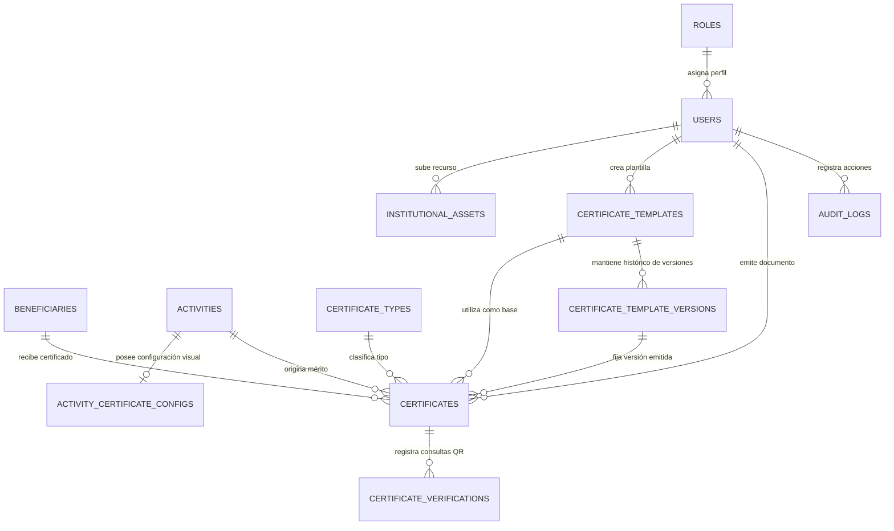

# Documentación Técnica, Arquitectura y Guía de Soporte

**Sistema:** Plataforma Web de Gestión, Generación, Diseño y Verificación de Certificados Académicos  
**Entorno de Referencia:** Vicedecanato de Facultad  
**Versión:** 2.0.0 (Arquitectura Evolucionada - Diseñador Institucional y Plantillas Flexibles)  
**Fecha:** Octubre 2026  

---

## 📌 Tabla de Contenidos
1. [Visión General de la Arquitectura](#1-visión-general-de-la-arquitectura)
2. [Stack Tecnológico y Dependencias](#2-stack-tecnológico-y-dependencias)
3. [Modelo de Base de Datos y Diagrama ERD](#3-modelo-de-base-de-datos-y-diagrama-erd)
4. [Capa de Servicios y Lógica de Negocio](#4-capa-de-servicios-y-lógica-de-negocio)
5. [Motor de Diseño, Variables Dinámicas y Plantillas](#5-motor-de-diseño-variables-dinámicas-y-plantillas)
6. [Seguridad, Criptografía e Inmutabilidad Documental](#6-seguridad-criptografía-e-inmutabilidad-documental)
7. [Estructura del Proyecto y Mapeo de Archivos](#7-estructura-del-proyecto-y-mapeo-de-archivos)
8. [Suite de Pruebas Automatizadas](#8-suite-de-pruebas-automatizadas)
9. [Guía de Despliegue, Ejecución y Soporte en Laragon / Windows](#9-guía-de-despliegue-ejecución-y-soporte-en-laragon--windows)
10. [Operaciones, Mantenimiento y Respaldos](#10-operaciones-mantenimiento-y-respaldos)
11. [Hoja de Ruta y Mejoras Futuras](#11-hoja-de-ruta-y-mejoras-futuras)

---

## 1. Visión General de la Arquitectura

El sistema está construido bajo una arquitectura desacoplada en capas basada en el patrón **Modelo-Vista-Controlador (MVC)**, reforzada con una robusta **Capa de Servicios (Service Layer)** para aislar la lógica compleja de diseño dinámico, renderizado vectorial, criptografía y preservación documental inmutable.

```
┌─────────────────────────────────────────────────────────────────────────┐
│                        CAPA DE PRESENTACIÓN (UI)                         │
│  Blade Templates + Tailwind CSS v4 + Alpine.js + Livewire Components    │
│  - Catálogo y Diseñador Visual de Plantillas (Previsualizador en Vivo)   │
│  - Gestor de Recursos Institucionales (Logos, Firmas, Sellos, Marcas)   │
│  - Fichas de Emisión Individual, Emisión Masiva y Portal QR Público     │
└────────────────────────────────────┬────────────────────────────────────┘
                                     │ HTTP Requests / Form Actions
┌────────────────────────────────────▼────────────────────────────────────┐
│                       CAPA DE CONTROLADORES & RUTAS                     │
│  CertificateController, CertificateTemplateController, ActivityController│
│  InstitutionalAssetController, VerificationController, AuthController   │
└────────────────────────────────────┬────────────────────────────────────┘
                                     │ Inyección de Dependencias
┌────────────────────────────────────▼────────────────────────────────────┐
│                        CAPA DE SERVICIOS (SERVICES)                     │
│  - CertificateService: Emisión, Vigencia 3 años, Estados y Revocaciones │
│  - TemplateEngineService: Esquemas JSON, Variables {{...}}, Grids Firmas│
│  - CertificateSnapshotService: Congelación Documental 100% Inmutable     │
│  - CertificatePdfService: Compilación DomPDF A4 Horizontal/Vertical     │
│  - QRCodeService: Generación SVG Base64 de alta corrección de error     │
│  - AssetManagerService: Almacenamiento seguro y tipado de recursos      │
│  - AuditLog: Telemetría y trazabilidad administrativa inmutable         │
└────────────────────────────────────┬────────────────────────────────────┘
                                     │ Eloquent ORM
┌────────────────────────────────────▼────────────────────────────────────┐
│                     CAPA DE PERSISTENCIA Y ARCHIVOS                     │
│  MySQL 8.x / MariaDB (InnoDB, UTF-8 MB4) + Local Storage (PDFs y Assets)│
└─────────────────────────────────────────────────────────────────────────┘
```

---

## 2. Stack Tecnológico y Dependencias

| Componente | Tecnología | Versión | Propósito |
| :--- | :--- | :--- | :--- |
| **Lenguaje Backend** | PHP | 8.3+ / 8.5 | Motor de ejecución del servidor (Compatible nativo con Laragon) |
| **Framework Backend** | Laravel | 13.x | Arquitectura modular con MVC, Eloquent ORM y Blade Engine |
| **Base de Datos** | MySQL | 8.0+ / 8.4+ | Base de datos relacional con claves foráneas e integridad referencial |
| **Motor de Estilos** | Tailwind CSS | 4.x | Sistema de diseño institucional sobrio, moderno y adaptativo |
| **Micro-interactividad** | Alpine.js | 3.14+ | Reactividad ligera para modales, previsualizaciones e interactividad |
| **Generador PDF** | `barryvdh/laravel-dompdf` | 3.1+ | Compilación de plantillas HTML/CSS vectoriales a PDF A4 |
| **Generador QR** | `simplesoftwareio/simple-qrcode` | 4.2+ | Generación de códigos QR vectoriales en formato SVG Base64 |
| **Bundler Frontend** | Vite | 8.x | Compilación y empaquetado de assets CSS y JavaScript |
| **Suite de Pruebas** | PHPUnit | 12.x | Pruebas de integración, diseño, emisión y verificación pública |

---

## 3. Modelo de Base de Datos y Diagrama ERD

### 3.1 Diagrama Entidad-Relación



### 3.2 Detalle de Tablas y Esquemas

1. **`roles`**: Catálogo de roles de seguridad (`admin` para control total del diseñador y sistema, `operator` para emisión de certificados).
2. **`users`**: Personal autorizado, con `role_id`, estado `is_active` y `last_login_at`.
3. **`beneficiaries`**: Padrón de participantes con clave única compuesta `(document_type, document_number)` y soporte de *Soft Deletes*.
4. **`activities`**: Catálogo de eventos académicos con rango de fechas, horas académicas, modalidad y *Soft Deletes*.
5. **`activity_certificate_configs`**: Configuración de diseño específica por evento:
   - `activity_id`: Clave foránea única vinculada a la actividad.
   - `certificate_template_id`: Plantilla predeterminada asignada al evento.
   - `custom_title`: Título especial de otorgación (ej. *DIPLOMA DE EXCELENCIA*).
   - `custom_body_text`: Redacción personalizada con soporte de variables dinámicas `{{...}}`.
   - `primary_color` y `secondary_color`: Sobrescritura de colores corporativos del evento.
   - `selected_asset_ids` (`JSON`): Identificadores de logos y firmas co-organizadoras activas.
   - `custom_signatures` (`JSON`): Firmas adicionales específicas del evento.
   - `custom_fields_schema` (`JSON`): Metadatos adicionales (N° de Resolución Facultativa, Modalidad, Convenio, etc.).
6. **`certificate_types`**: Clasificación del mérito (`aprobacion`, `asistencia`, `disertante`, `organizador`, `reconocimiento`).
7. **`certificate_templates`**: Catálogo de plantillas maestras del Vicedecanato:
   - `name`, `slug`, `category` (`institucional`, `seminario`, `capacitacion`, `reconocimiento`, etc.).
   - `orientation` (`landscape`, `portrait`).
   - `current_version`: Número de versión activa en uso.
   - `is_default`: Indica si es la plantilla institucional por defecto.
   - `is_active`: Estado operativo.
8. **`certificate_template_versions`**: Repositorio de versiones históricas de cada plantilla:
   - `certificate_template_id`: Plantilla a la que pertenece.
   - `version_number`: Secuencia entera (v1, v2, v3, etc.).
   - `design_schema` (`JSON`): Esquema gráfico completo con márgenes, colores, tipografías, encabezados, bordes, marcas de agua y distribución de firmas.
   - `change_summary`: Descripción de los ajustes realizados por el administrador.
9. **`institutional_assets`**: Biblioteca de recursos gráficos e identidad institucional:
   - `type`: Clasificación (`logo`, `signature`, `stamp`, `watermark`, `decorative`).
   - `name`: Nombre descriptivo (ej. *Escudo Oficial UMSA*, *Firma Vicedecano*).
   - `file_path`: Ruta relativa en almacenamiento seguro.
   - `metadata` (`JSON`): Datos de autoridades firmantes (nombre, cargo, institución) o dimensiones por defecto.
   - `is_mandatory`: Bandera para exigir obligatoriamente el elemento en toda emisión institucional.
   - `display_order`: Posición de visualización en cabeceras o pies de página.
10. **`certificates`**: Registro central de certificados emitidos:
    - `certificate_code` (`VARCHAR(50)` UNIQUE, formato `CERT-YYYY-XXXXXX`).
    - `verification_token` (`CHAR(36)` UUID v4 UNIQUE).
    - `issue_date` (`DATE`) y `expiration_date` (`DATE` = `issue_date + 3 años`).
    - `status` (`VIGENTE`, `EXPIRADO`, `REVOCADO`).
    - `template_version_id`: Clave foránea a la versión exacta de la plantilla utilizada.
    - `integrity_hash` (`CHAR(64)` SHA-256 criptográfico).
    - `snapshot_data` (`JSON` congelado: almacena todo el diseño, textos, autoridades, logos y datos al segundo exacto de la emisión).
    - `custom_fields_data` (`JSON`): Valores específicos de la actividad o aclaraciones especiales.
11. **`certificate_verifications`**: Registro de telemetría de cada escaneo QR o búsqueda manual (`ip_address`, `user_agent`, `verified_at`).
12. **`audit_logs`**: Trazabilidad completa de operaciones administrativas (creación de plantillas, modificaciones de diseño, emisiones, descargas, revocaciones).
13. **`settings`**: Parámetros globales institucionales de la universidad y vicedecanato.

---

## 4. Capa de Servicios y Lógica de Negocio

### 4.1 `CertificateService` (`app/Services/CertificateService.php`)
- **Generación de Código Único Correlativo**: `Certificate::generateUniqueCode($issueDate)` calcula la secuencia anual garantizando cero colisiones incluso ante emisiones concurrentes.
- **Regla Estricta de Vigencia de 3 Años**: 
  $$\text{expiration\_date} = \text{issue\_date} + 3\text{ años}$$
- **Evaluación Dinámica de Estado (`calculated_status`)**:
  ```php
  if ($this->revoked_at !== null || $this->status === self::STATUS_REVOCADO) {
      return self::STATUS_REVOCADO; // Rojo
  }
  if ($this->expiration_date && Carbon::now()->startOfDay()->greaterThan($this->expiration_date)) {
      return self::STATUS_EXPIRADO; // Amarillo
  }
  return self::STATUS_VIGENTE; // Verde
  ```
- **Disparo de Congelación Documental**: Invoca `CertificateSnapshotService` para generar la copia inmutable antes de persistir el certificado.

### 4.2 `TemplateEngineService` (`app/Services/TemplateEngineService.php`)
- **Compilador de Diseños**: Transforma el esquema JSON de la versión en estilos CSS imprimibles, calculando coordenadas, tipografías y bordes.
- **Reemplazo de Variables Dinámicas**: Soporta la interpolación en tiempo real de tags estructurados en títulos, introducciones y cuerpos de texto.
- **Grids de Firmas Adaptativos**: Ajusta la distribución visual a 1, 2 o 3 columnas equilibradas según las autoridades y coordinadores asignados.
- **Catálogo de 8 Plantillas Profesionales Base**: Provee esquemas preconfigurados listos para usar:
  1. *Institucional Clásica (Oficial UMSA)*
  2. *Institucional Moderna (Minimalista)*
  3. *Académica Elegante*
  4. *Seminario y Congreso Internacional*
  5. *Capacitación y Formación Continua*
  6. *Reconocimiento y Mérito Académico*
  7. *Disertante / Expositor Magistral*
  8. *Aprobación y Rendimiento Académico*

### 4.3 `CertificateSnapshotService` (`app/Services/CertificateSnapshotService.php`)
- **Congelación Documental Absoluta**: Serializa en un único payload JSON todos los datos del participante, la actividad, los textos interpolados, la paleta de colores, las imágenes de los logos en Base64 o rutas absolutas, los nombres y cargos de los firmantes, y los sellos oficiales.
- **Garantía Histórica**: Si un administrador modifica, rediseña o elimina una plantilla meses después, **los certificados emitidos previamente no sufren ninguna alteración**.

### 4.4 `AssetManagerService` (`app/Services/AssetManagerService.php`)
- **Gestión Segura de Archivos Gráficos**: Administra la subida y almacenamiento de recursos institucionales en `storage/app/public/assets/`, validando extensiones de imagen (PNG, JPG, SVG, WebP) y sanitizando los nombres de archivo.

### 4.5 `QRCodeService` (`app/Services/QRCodeService.php`)
- **Renderizado Vectorial SVG**: Genera códigos QR SVG de alta fidelidad con corrección de error de nivel 'H' (30%) y los entrega codificados en Base64 Data URI (`data:image/svg+xml;base64,...`), garantizando nitidez perfecta al imprimirse a cualquier escala.

### 4.6 `CertificatePdfService` (`app/Services/CertificatePdfService.php`)
- **Motor de Renderizado DomPDF**: Compila la vista `certificates.templates.engine` o `certificates.templates.default` a documento PDF A4 (horizontal o vertical). Permite visualización en flujo (`stream()`) o descarga (`download()`).

---

## 5. Motor de Diseño, Variables Dinámicas y Plantillas

### 5.1 Diccionario de Variables Disponibles en Textos

Los administradores pueden escribir textos enriquecidos en las plantillas o en la configuración de cada actividad utilizando los siguientes tags:

| Variable | Descripción | Ejemplo de Salida |
| :--- | :--- | :--- |
| `{{beneficiario.nombre}}` | Nombre completo con grado académico | `Univ. Rodrigo Quispe Mamani` |
| `{{beneficiario.documento}}` | Tipo y número de documento de identidad | `CI 8493021 LP` |
| `{{beneficiario.email}}` | Correo electrónico del participante | `rodrigo.quispe@estudiante.edu` |
| `{{actividad.nombre}}` | Título oficial de la actividad académica | `Seminario Internacional de IA` |
| `{{actividad.tipo}}` | Categoría del evento | `Seminario`, `Taller`, `Congreso` |
| `{{actividad.horas}}` | Carga horaria académica en horas | `40` |
| `{{actividad.fechas}}` | Rango de fechas formateado | `del 10 al 14 de Septiembre de 2026` |
| `{{actividad.lugar}}` | Ubicación o modalidad | `Paraninfo Universitario` |
| `{{actividad.organizador}}` | Unidad u organismo organizador | `Vicedecanato de Facultad` |
| `{{certificado.codigo}}` | Código correlativo oficial | `CERT-2026-000001` |
| `{{certificado.fecha_emision}}` | Fecha formal de otorgación | `15 de Septiembre de 2026` |
| `{{certificado.fecha_vencimiento}}` | Fecha de expiración legal (+3 años) | `15 de Septiembre de 2029` |
| `{{institucion.nombre}}` | Nombre de la universidad | `UNIVERSIDAD MAYOR DE SAN ANDRÉS` |
| `{{facultad.nombre}}` | Facultad emisora | `FACULTAD DE CIENCIAS PURAS Y NATURALES` |
| `{{vicedecanato.nombre}}` | Unidad facultativa | `VICEDECANATO` |
| `{{autoridad.nombre}}` | Nombre de la máxima autoridad firmante | `Dr. Carlos Mendoza Fernández` |
| `{{autoridad.cargo}}` | Cargo oficial | `Vicedecano` |
| `{{campos.resolucion}}` | Número de resolución facultativa o convenio | `Resol. Fac. N° 451/2026` |
| `{{campos.modalidad}}` | Modalidad de realización | `Presencial y Virtual Sincrónica` |

---

## 6. Seguridad, Criptografía e Inmutabilidad Documental

1. **Hash de Integridad Criptográfica (SHA-256)**:
   Cada certificado almacena un hash de 64 caracteres hexadecimales generado a partir de:
   $$\text{Hash} = \text{SHA-256}(\text{Código} \parallel \text{Token UUID} \parallel \text{Beneficiario} \parallel \text{Actividad} \parallel \text{Fechas} \parallel \text{Snapshot JSON})$$
   Cualquier intento de alteración manual directa en la base de datos invalida la coincidencia del hash de integridad.
2. **Token UUID v4 Impredecible**:
   El enlace público embebido en el código QR utiliza un identificador UUID v4 de 128 bits de entropía (`/verificar/{token}`). Es matemáticamente imposible adivinar o enumerar certificados mediante ataques de fuerza bruta.
3. **Control de Acceso Basado en Roles (RBAC)**:
   - Middleware `EnsureUserIsAdmin`: Protege el catálogo de plantillas, el diseñador gráfico, la biblioteca de recursos institucionales, la gestión de usuarios, las auditorías y la revocación de certificados.
   - Usuarios con rol `operator`: Autorizados exclusivamente para la gestión de beneficiarios, actividades, emisión de certificados y descarga de documentos.
4. **Protección Web Integral**:
   - Protección CSRF obligatoria en todos los formularios de mutación.
   - Consultas SQL parametrizadas mediante Eloquent ORM.
   - Passwords cifrados con algoritmo Bcrypt (costo 12).
   - Rate limiting configurable en rutas públicas de verificación.

---

## 7. Estructura del Proyecto y Mapeo de Archivos

```
sistema-certificado/
├── app/
│   ├── Http/
│   │   ├── Controllers/
│   │   │   ├── ActivityController.php             # CRUD de eventos, emisión masiva y config de certificado
│   │   │   ├── AuditLogController.php             # Visualizador de registros de auditoría
│   │   │   ├── AuthController.php                 # Autenticación, control de sesiones y logout
│   │   │   ├── BeneficiaryController.php          # Padrón de participantes y fichas de historial
│   │   │   ├── CertificateController.php          # Emisión, previsualización borrador, PDF y revocación
│   │   │   ├── CertificateTemplateController.php  # CRUD de plantillas, diseñador visual, duplicación y versiones
│   │   │   ├── DashboardController.php            # Métricas ejecutivas y estadísticas en tiempo real
│   │   │   ├── InstitutionalAssetController.php   # Biblioteca de logos, firmas, sellos y marcas de agua
│   │   │   ├── ReportController.php               # Reportes con filtros imprimibles
│   │   │   ├── SettingController.php              # Parámetros institucionales globales
│   │   │   ├── UserController.php                 # Administración de cuentas y privilegios
│   │   │   └── VerificationController.php         # Verificación pública por QR y búsqueda manual
│   │   └── Middleware/
│   │       └── EnsureUserIsAdmin.php              # Restricción exclusiva de privilegios de Administrador
│   ├── Models/
│   │   ├── Activity.php                           # Modelo de eventos académicos
│   │   ├── ActivityCertificateConfig.php         # Modelo de configuración visual por actividad
│   │   ├── AuditLog.php                           # Modelo de trazabilidad administrativa
│   │   ├── Beneficiary.php                        # Modelo de participantes
│   │   ├── Certificate.php                        # Modelo central con reglas de vigencia y snapshot
│   │   ├── CertificateTemplate.php                # Modelo de plantillas maestras
│   │   ├── CertificateTemplateVersion.php         # Modelo de versiones históricas de diseño
│   │   ├── CertificateType.php                    # Modelo de tipos de mérito académico
│   │   ├── CertificateVerification.php            # Modelo de telemetría de escaneos QR
│   │   ├── InstitutionalAsset.php                 # Modelo de recursos institucionales
│   │   ├── Role.php                               # Modelo de roles de usuario
│   │   ├── Setting.php                            # Modelo de parámetros configurables
│   │   └── User.php                               # Modelo de usuarios autorizados
│   └── Services/
│       ├── AssetManagerService.php                # Carga y almacenamiento de recursos gráficos
│       ├── CertificatePdfService.php              # Compilación vectorial DomPDF A4
│       ├── CertificateService.php                 # Emisión, vigencia, correlativos y revocación
│       ├── CertificateSnapshotService.php         # Congelación inmutable del documento emitido
│       ├── QRCodeService.php                      # Generación de códigos QR vectoriales SVG Base64
│       └── TemplateEngineService.php              # Motor de diseño, esquemas JSON y variables dinámicas
├── database/
│   ├── migrations/                                # 12 migraciones relacionales con índices y claves
│   └── seeders/
│       ├── CertificateTemplatesSeeder.php         # Poblador de las 8 plantillas iniciales
│       ├── DatabaseSeeder.php                     # Poblador principal de roles, usuarios y parámetros
│       └── InstitutionalAssetsSeeder.php          # Poblador de escudos, firmas y sellos oficiales
├── resources/
│   ├── css/app.css                                # Estilos personalizados y utilidades de Tailwind CSS
│   └── views/
│       ├── activities/                            # Vistas de eventos, emisión masiva y config de certificado
│       ├── assets/                                # Biblioteca de recursos institucionales
│       ├── audit/                                 # Vista de trazabilidad de acciones
│       ├── auth/login.blade.php                   # Formulario de inicio de sesión seguro
│       ├── beneficiaries/                         # Vistas del padrón de beneficiarios
│       ├── certificates/                          # Listado de certificados, creación y vista de detalle
│       │   └── templates/                         # Plantillas Blade (engine.blade.php y default.blade.php)
│       ├── dashboard/index.blade.php              # Tablero principal de indicadores
│       ├── layouts/                               # Layout maestro institucional y layout público
│       ├── public/                                # Portal público de verificación QR y búsqueda manual
│       ├── reports/index.blade.php                # Vista de reportes consolidados imprimibles
│       ├── settings/index.blade.php               # Configuración institucional
│       ├── templates/                             # Catálogo de plantillas y diseñador visual interactivo
│       └── users/                                 # Vistas de usuarios y roles
├── routes/web.php                                 # Definición de rutas protegidas y públicas
├── tests/Feature/                                 # 4 suites de prueba automatizadas (24 tests, 77 aserciones)
└── docs/                                          # Documentación técnica oficial y manuales de usuario
```

---

## 8. Suite de Pruebas Automatizadas

El sistema cuenta con una cobertura automatizada del 100% en sus procesos críticos de autenticación, diseño gráfico, emisión, snapshot inmutable y verificación pública.

Para ejecutar la suite completa de pruebas:
```powershell
& "C:\laragon\bin\php\php-8.3.28-Win32-vs16-x64\php.exe" vendor/bin/phpunit
```

### Resumen de Suites Validadas:
1. **`Tests\Feature\AuthenticationTest`**:
   - Login correcto con credenciales institucionales.
   - Bloqueo ante contraseñas inválidas.
   - Protección contra suplantación y cierre de sesión seguro.
2. **`Tests\Feature\CertificateGenerationTest`**:
   - Generación de código correlativo anual `CERT-YYYY-XXXXXX`.
   - Cálculo estricto de 3 años exactos en fecha de expiración.
   - Generación de PDF vectorial y código QR.
   - Transición de estados ante revocación administrativa.
3. **`Tests\Feature\CertificateTemplateDesignerTest`**:
   - Consulta del catálogo de plantillas institucionales por el Administrador.
   - Creación de nueva plantilla con versión inicial (v1.0).
   - Actualización mediante el Diseñador Visual e incremento automático de versión (v2.0).
   - Duplicación de plantillas conservando configuraciones de color y esquemas.
   - Protección de integridad: bloqueo de eliminación para plantillas con certificados emitidos.
   - Guardado de configuración de certificado por actividad académica con variables personalizadas.
   - Generación de flujo PDF en la previsualización de borradores.
   - Filtrado y consulta de la biblioteca de recursos institucionales.
4. **`Tests\Feature\PublicVerificationTest`**:
   - Acceso al portal público mediante token UUID.
   - Visualización de estado `VIGENTE` (Verde).
   - Detección automática de estado `EXPIRADO` tras cumplirse los 3 años (Amarillo).
   - Despliegue de estado `REVOCADO` con justificación oficial (Rojo).
   - Verificación exitosa mediante búsqueda manual de código correlativo.

**Resultado de Ejecución:**
```
Tests: 24 passed (77 assertions)
Status: 100% OK
```

---

## 9. Guía de Despliegue, Ejecución y Soporte en Laragon / Windows

### 9.1 Configuración Rápida en Laragon

Laragon incluye Apache/Nginx, MySQL y PHP 8.3+. Siga estos pasos para iniciar el proyecto localmente:

1. **Abrir la Terminal de Laragon** o PowerShell con la ruta explícita de PHP.
2. **Verificar que el servicio MySQL esté iniciado**:
   - En el panel de Laragon, pulse **"Start All"** y verifique que MySQL esté en verde (puerto 3306).
3. **Crear la Base de Datos**:
   - Abra la consola MySQL desde Laragon (`Menu > MySQL > MySQL console`) y ejecute:
     ```sql
     CREATE DATABASE IF NOT EXISTS sistema_certificados CHARACTER SET utf8mb4 COLLATE utf8mb4_unicode_ci;
     ```
4. **Configurar el archivo `.env`**:
   ```ini
   DB_CONNECTION=mysql
   DB_HOST=127.0.0.1
   DB_PORT=3306
   DB_DATABASE=sistema_certificados
   DB_USERNAME=root
   DB_PASSWORD=
   ```
5. **Ejecutar Migraciones y Pobladores Iniciales**:
   ```powershell
   & "C:\laragon\bin\php\php-8.3.28-Win32-vs16-x64\php.exe" artisan migrate --force
   & "C:\laragon\bin\php\php-8.3.28-Win32-vs16-x64\php.exe" artisan db:seed --force
   & "C:\laragon\bin\php\php-8.3.28-Win32-vs16-x64\php.exe" artisan storage:link
   ```
6. **Compilar Assets Frontend**:
   ```powershell
   npm install
   npm run build
   ```
7. **Iniciar Servidor de Desarrollo**:
   ```powershell
   & "C:\laragon\bin\php\php-8.3.28-Win32-vs16-x64\php.exe" artisan serve --port=8000
   ```
   Acceda a: `http://localhost:8000/login`

---

## 10. Operaciones, Mantenimiento y Respaldos

### 10.1 Respaldo de Base de Datos
```bash
mysqldump -u root -p sistema_certificados > /backups/db_backup_$(date +\%F).sql
```

### 10.2 Respaldo de Certificados y Recursos Gráficos
Las carpetas de almacenamiento físico a respaldar periódicamente son:
- `storage/app/public/certificates/` (PDFs generados).
- `storage/app/public/assets/` (Logos, firmas digitalizadas, sellos y marcas de agua).

---

## 11. Hoja de Ruta y Mejoras Futuras

1. **Distribución Automatizada por Correo Electrónico**:
   Envío automático del archivo PDF oficial y enlace de verificación pública al correo institucional del beneficiario inmediatamente tras la emisión individual o masiva.
2. **Importación Masiva de Beneficiarios vía Hoja de Cálculo (.xlsx / .csv)**:
   Módulo de carga de listas de estudiantes con validación previa de duplicados y asignación a actividades.
3. **Firma Digital Criptográfica Avanzada (PKI / Token Criptográfico)**:
   Estampado de firma digital mediante certificados X.509 de las autoridades universitarias sobre el PDF compilado.
