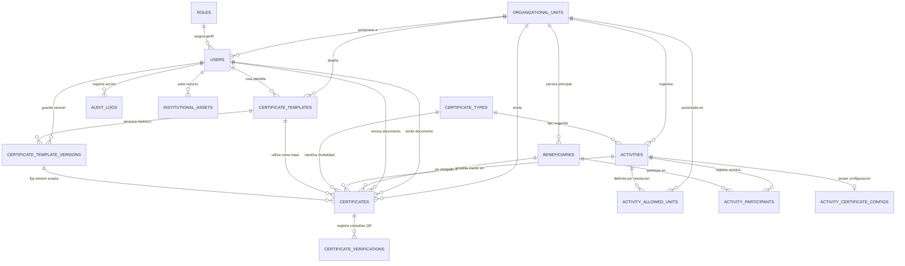

# Documentación y Diagrama de Base de Datos

**Sistema:** Plataforma Web de Gestión, Emisión, Diseño y Verificación de Certificados Académicos con Código QR  
**Institución:** Facultad de Tecnología — Universidad Mayor de San Andrés (UMSA)  
**Motor de Base de Datos:** MySQL 8.0+ / 8.4+ (Motor de Almacenamiento InnoDB, Codificación `utf8mb4_unicode_ci`)  
**Versión:** 2.5.0 (Esquema Multitenant de Carreras, Resoluciones y Padrón Único)  
**Fecha de Actualización:** Noviembre 2026  

---

## 📌 Tabla de Contenidos

1. [Visión General de la Base de Datos](#1-visión-general-de-la-base-de-datos)
2. [Diagrama Entidad-Relación Completo (Mermaid)](#2-diagrama-entidad-relación-completo-mermaid)
3. [Diccionario de Datos Detallado](#3-diccionario-de-datos-detallado)
   - [3.1 Módulo Organizacional y Multitenancy](#31-módulo-organizacional-y-multitenancy)
   - [3.2 Módulo de Seguridad, Roles y Usuarios](#32-módulo-de-seguridad-roles-y-usuarios)
   - [3.3 Módulo de Beneficiarios y Portafolio Académico](#33-módulo-de-beneficiarios-y-portafolio-académico)
   - [3.4 Módulo de Actividades Académicas y Resoluciones](#34-módulo-de-actividades-académicas-y-resoluciones)
   - [3.5 Módulo de Plantillas, Versiones y Diseñador Visual](#35-módulo-de-plantillas-versiones-y-diseñador-visual)
   - [3.6 Módulo de Certificados, Tipos y Verificación Pública](#36-módulo-de-certificados-tipos-y-verificación-pública)
   - [3.7 Módulo de Auditoría y Recursos Institucionales](#37-módulo-de-auditoría-y-recursos-institucionales)
4. [Estructura de Esquemas JSON Almacenados](#4-estructura-de-esquemas-json-almacenados)
   - [4.1 `design_schema` (Diseñador Visual de Plantillas)](#41-design_schema-diseñador-visual-de-plantillas)
   - [4.2 `snapshot_data` (Inmutabilidad Documental y Notas)](#42-snapshot_data-inmutabilidad-documental-y-notas)
5. [Matriz de Claves Foráneas e Integridad Referencial](#5-matriz-de-claves-foráneas-e-integridad-referencial)
6. [Instrucciones de Exportación y Respaldo](#6-instrucciones-de-exportación-y-respaldo)

---

## 1. Visión General de la Base de Datos

La base de datos `sistema_certificados` implementa un modelo de datos robusto enfocado en la integridad académica, el aislamiento por carreras y la preservación jurídica a largo plazo:

1. **Aislamiento Multitenant de Carreras (`organizational_units`)**:
   Las 9 carreras oficiales de la Facultad de Tecnología y sus departamentos administrativos gestionan sus actividades, certificados y plantillas con estricto aislamiento de datos, mientras que el Super Administrador mantiene una vista consolidada mediante llaves foráneas indexadas.
2. **Padrón Único de Beneficiarios**:
   Cada estudiante o docente se identifica de forma única mediante su C.I. (`document_number`), permitiendo que su **Portafolio Académico 360°** consolide en una sola vista todos los certificados obtenidos a lo largo de su carrera en la Facultad.
3. **Control Normativo por Resolución Facultativa**:
   Las actividades académicas registran su número de resolución (`resolution_number`) y su modo de audiencia (`target_audience_mode`), restringiendo la certificación solo a las carreras autorizadas mediante la tabla intermedia `activity_allowed_units`.
4. **Regla Ética de Aprobación Reglamentaria**:
   La tabla pivot `activity_participants` almacena calificaciones numéricas y flags de elegibilidad (`career_eligible`), asegurando que ningún participante con nota menor a 51 pts reciba certificación en actividades evaluadas.
5. **Inmutabilidad y Sellado Criptográfico (Regla 40)**:
   Cada certificado emitido congela su representación exacta en un snapshot JSON (`snapshot_data`) y un hash criptográfico SHA-256 (`integrity_hash`), haciéndolo inmune a futuros cambios de autoridades, nombres o plantillas.

---

## 2. Diagrama Entidad-Relación Completo (Mermaid)



---

## 3. Diccionario de Datos Detallado

### 3.1 Módulo Organizacional y Multitenancy

#### Tabla: `organizational_units`
Almacena las carreras universitarias y departamentos administrativos de la Facultad de Tecnología.

| Columna | Tipo de Dato | Nulo | Clave | Valor por Defecto | Descripción |
| :--- | :--- | :---: | :---: | :---: | :--- |
| `id` | `BIGINT UNSIGNED` | NO | PK | Auto-incremental | Identificador único de la unidad |
| `name` | `VARCHAR(255)` | NO | | | Nombre oficial (Ej.: *Carrera de Química Industrial*) |
| `code` | `VARCHAR(20)` | NO | UK | | Código o sigla institucional única (Ej.: `QUI`, `MEC`, `CIV`) |
| `type` | `VARCHAR(50)` | NO | | `'carrera'` | Tipo: `carrera`, `departamento`, `instituto`, `administrativo` |
| `faculty_name` | `VARCHAR(255)` | NO | | `'Facultad de Tecnología'` | Facultad universitaria a la que pertenece |
| `responsible_title` | `VARCHAR(100)` | YES | | `NULL` | Título de la autoridad (Ej.: *Director de Carrera*, *Jefe*) |
| `responsible_name` | `VARCHAR(255)` | YES | | `NULL` | Nombre y apellidos de la autoridad en funciones |
| `is_active` | `TINYINT(1)` | NO | | `1` | Estado operativo (`1` = Activa, `0` = Suspendida temporalmente) |
| `description` | `TEXT` | YES | | `NULL` | Notas u observaciones sobre la unidad |
| `created_at` | `TIMESTAMP` | YES | | `NULL` | Fecha de creación del registro |
| `updated_at` | `TIMESTAMP` | YES | | `NULL` | Fecha de última modificación |

---

### 3.2 Módulo de Seguridad, Roles y Usuarios

#### Tabla: `roles`
Catálogo de roles del sistema con su nivel de jerarquía y alcance institucional.

| Columna | Tipo de Dato | Nulo | Clave | Valor por Defecto | Descripción |
| :--- | :--- | :---: | :---: | :---: | :--- |
| `id` | `BIGINT UNSIGNED` | NO | PK | Auto-incremental | Identificador del rol |
| `name` | `VARCHAR(50)` | NO | UK | | Slug canónico: `admin`, `jefe_carrera`, `secretaria`, `operator` |
| `display_name` | `VARCHAR(100)` | NO | | | Nombre para mostrar en pantalla |
| `description` | `VARCHAR(255)` | YES | | `NULL` | Descripción de responsabilidades |
| `created_at` | `TIMESTAMP` | YES | | `NULL` | Fecha de creación |
| `updated_at` | `TIMESTAMP` | YES | | `NULL` | Fecha de actualización |

#### Tabla: `users`
Cuentas de usuario de funcionarios universitarios vinculadas a su unidad organizacional.

| Columna | Tipo de Dato | Nulo | Clave | Valor por Defecto | Descripción |
| :--- | :--- | :---: | :---: | :---: | :--- |
| `id` | `BIGINT UNSIGNED` | NO | PK | Auto-incremental | Identificador del usuario |
| `role_id` | `BIGINT UNSIGNED` | NO | FK | | Referencia a `roles.id` |
| `organizational_unit_id`| `BIGINT UNSIGNED` | YES | FK | `NULL` | Referencia a `organizational_units.id` (Carrera a la que pertenece) |
| `name` | `VARCHAR(255)` | NO | | | Nombre completo del funcionario |
| `email` | `VARCHAR(255)` | NO | UK | | Correo institucional |
| `password` | `VARCHAR(255)` | NO | | | Contraseña encriptada con algoritmo Bcrypt |
| `is_active` | `TINYINT(1)` | NO | | `1` | Estado de la cuenta (`1` = Activa, `0` = Inactiva) |
| `last_login_at` | `TIMESTAMP` | YES | | `NULL` | Registro de último acceso al sistema |
| `remember_token` | `VARCHAR(100)` | YES | | `NULL` | Token de sesión persistente |
| `created_at` | `TIMESTAMP` | YES | | `NULL` | Fecha de registro |
| `updated_at` | `TIMESTAMP` | YES | | `NULL` | Fecha de actualización |

---

### 3.3 Módulo de Beneficiarios y Portafolio Académico

#### Tabla: `beneficiaries`
Padrón único de estudiantes, docentes y participantes externos identificados por C.I.

| Columna | Tipo de Dato | Nulo | Clave | Valor por Defecto | Descripción |
| :--- | :--- | :---: | :---: | :---: | :--- |
| `id` | `BIGINT UNSIGNED` | NO | PK | Auto-incremental | Identificador del beneficiario |
| `document_type` | `VARCHAR(20)` | NO | | `'CI'` | Tipo de documento (`CI`, `PASAPORTE`, `DNI`) |
| `document_number` | `VARCHAR(50)` | NO | UK | | Número de documento único (CI normalizado) |
| `first_name` | `VARCHAR(100)` | NO | | | Nombres del beneficiario |
| `last_name` | `VARCHAR(100)` | NO | | | Apellidos del beneficiario |
| `academic_title` | `VARCHAR(50)` | YES | | `NULL` | Título académico de cortesía (Ej.: *Univ.*, *Ing.*, *Lic.*) |
| `email` | `VARCHAR(255)` | YES | | `NULL` | Correo electrónico de contacto |
| `phone` | `VARCHAR(50)` | YES | | `NULL` | Teléfono / celular de contacto |
| `institution_or_department`| `VARCHAR(255)` | YES | | `NULL` | Institución o institución de procedencia |
| `primary_organizational_unit_id`| `BIGINT UNSIGNED` | YES | FK | `NULL` | Referencia a `organizational_units.id` (Carrera principal del alumno) |
| `notes` | `TEXT` | YES | | `NULL` | Observaciones administrativas |
| `created_at` | `TIMESTAMP` | YES | | `NULL` | Fecha de alta en el padrón |
| `updated_at` | `TIMESTAMP` | YES | | `NULL` | Fecha de modificación |
| `deleted_at` | `TIMESTAMP` | YES | | `NULL` | Borrado lógico (*SoftDeletes*) |

---

### 3.4 Módulo de Actividades Académicas y Resoluciones

#### Tabla: `activities`
Eventos, talleres, seminarios y cursos organizados por la Facultad o por carreras individuales.

| Columna | Tipo de Dato | Nulo | Clave | Valor por Defecto | Descripción |
| :--- | :--- | :---: | :---: | :---: | :--- |
| `id` | `BIGINT UNSIGNED` | NO | PK | Auto-incremental | Identificador de la actividad |
| `organizational_unit_id`| `BIGINT UNSIGNED` | YES | FK | `NULL` | Unidad o carrera organizadora (`organizational_units.id`) |
| `name` | `VARCHAR(255)` | NO | | | Título oficial de la actividad académica |
| `description` | `TEXT` | YES | | `NULL` | Descripción y objetivos del evento |
| `activity_type` | `VARCHAR(80)` | NO | | `'Seminario'` | Categoría: `Curso`, `Seminario`, `Taller`, `Congreso`, etc. |
| `certificate_type_id` | `BIGINT UNSIGNED` | YES | FK | `NULL` | Tipo de certificado por defecto (`certificate_types.id`) |
| `start_date` | `DATE` | NO | | | Fecha de inicio del evento |
| `end_date` | `DATE` | NO | | | Fecha de culminación del evento |
| `academic_hours` | `INT UNSIGNED` | NO | | `0` | Carga horaria académica certificada |
| `resolution_number` | `VARCHAR(100)` | YES | | `NULL` | Número de Resolución Facultativa oficial (Ej.: *RF-045/2026*) |
| `target_audience_mode` | `VARCHAR(50)` | NO | | `'own_unit'` | Alcance: `own_unit`, `all_faculty`, `specific_units` |
| `location` | `VARCHAR(255)` | YES | | `NULL` | Lugar o modalidad (Presencial, Virtual) |
| `organizer` | `VARCHAR(255)` | YES | | `NULL` | Nombre de la entidad organizadora |
| `responsible_authority` | `VARCHAR(255)` | YES | | `NULL` | Nombre y cargo de la autoridad responsable |
| `status` | `VARCHAR(30)` | NO | | `'activa'` | Estado: `activa`, `finalizada`, `cancelada` |
| `created_at` | `TIMESTAMP` | YES | | `NULL` | Fecha de registro |
| `updated_at` | `TIMESTAMP` | YES | | `NULL` | Fecha de modificación |
| `deleted_at` | `TIMESTAMP` | YES | | `NULL` | Borrado lógico (*SoftDeletes*) |

#### Tabla: `activity_allowed_units`
Tabla intermedia que define qué carreras están autorizadas a participar en un evento inter-carrera por Resolución Facultativa (`target_audience_mode = 'specific_units'`).

| Columna | Tipo de Dato | Nulo | Clave | Valor por Defecto | Descripción |
| :--- | :--- | :---: | :---: | :---: | :--- |
| `id` | `BIGINT UNSIGNED` | NO | PK | Auto-incremental | Identificador de la relación |
| `activity_id` | `BIGINT UNSIGNED` | NO | FK | | Referencia a `activities.id` (ON DELETE CASCADE) |
| `organizational_unit_id`| `BIGINT UNSIGNED` | NO | FK | | Referencia a `organizational_units.id` (ON DELETE CASCADE) |
| `created_at` | `TIMESTAMP` | YES | | `NULL` | Fecha de asociación |
| `updated_at` | `TIMESTAMP` | YES | | `NULL` | Fecha de actualización |

#### Tabla: `activity_participants`
Nómina de estudiantes inscritos en una actividad con su registro de calificaciones y elegibilidad de carrera.

| Columna | Tipo de Dato | Nulo | Clave | Valor por Defecto | Descripción |
| :--- | :--- | :---: | :---: | :---: | :--- |
| `id` | `BIGINT UNSIGNED` | NO | PK | Auto-incremental | Identificador de inscripción |
| `activity_id` | `BIGINT UNSIGNED` | NO | FK | | Referencia a `activities.id` |
| `beneficiary_id` | `BIGINT UNSIGNED` | NO | FK | | Referencia a `beneficiaries.id` |
| `role` | `VARCHAR(50)` | NO | | `'Participante'` | Rol: `Participante`, `Aprobado`, `Disertante`, etc. |
| `status` | `VARCHAR(30)` | NO | | `'inscrito'` | Estado: `inscrito`, `certificado`, `reprobado`, `observado` |
| `career_eligible` | `TINYINT(1)` | NO | | `1` | Flag de cumplimiento de resolución (`1` = Habilitado, `0` = No permitido) |
| `ineligibility_reason` | `VARCHAR(255)` | YES | | `NULL` | Causa de inhabilitación (Ej.: *Carrera no autorizada según RF-045/2026*) |
| `score` | `DECIMAL(5,2)` | YES | | `NULL` | Calificación numérica (0 a 100 pts) |
| `score_label` | `VARCHAR(100)` | YES | | `NULL` | Mención cualitativa (Ej.: *Sobresaliente*, *Aprobado*) |
| `created_at` | `TIMESTAMP` | YES | | `NULL` | Fecha de inscripción |
| `updated_at` | `TIMESTAMP` | YES | | `NULL` | Fecha de modificación |

---

### 3.5 Módulo de Plantillas, Versiones y Diseñador Visual

#### Tabla: `certificate_templates`
Catálogo de plantillas de diseño visual para certificados A4.

| Columna | Tipo de Dato | Nulo | Clave | Valor por Defecto | Descripción |
| :--- | :--- | :---: | :---: | :---: | :--- |
| `id` | `BIGINT UNSIGNED` | NO | PK | Auto-incremental | Identificador de la plantilla |
| `organizational_unit_id`| `BIGINT UNSIGNED` | YES | FK | `NULL` | Unidad propietaria (`NULL` = Plantilla global de Facultad) |
| `name` | `VARCHAR(255)` | NO | | | Nombre descriptivo de la plantilla |
| `slug` | `VARCHAR(255)` | NO | UK | | Identificador textual único |
| `category` | `VARCHAR(50)` | NO | | `'institucional'` | Categoría de diseño |
| `description` | `TEXT` | YES | | `NULL` | Descripción y propósito del diseño |
| `orientation` | `VARCHAR(20)` | NO | | `'landscape'` | Orientación: `landscape` (horizontal) o `portrait` (vertical) |
| `background_image` | `VARCHAR(255)` | YES | | `NULL` | Ruta de la imagen ornamental de fondo |
| `configuration` | `JSON` | NO | | | Esquema de diseño JSON (`design_schema`) |
| `current_version` | `INT UNSIGNED` | NO | | `1` | Número de versión activa |
| `is_active` | `TINYINT(1)` | NO | | `1` | Estado de la plantilla |
| `is_default` | `TINYINT(1)` | NO | | `0` | Bandera de plantilla predeterminada de la unidad |
| `created_by_user_id` | `BIGINT UNSIGNED` | YES | FK | `NULL` | Usuario que creó la plantilla |
| `created_at` | `TIMESTAMP` | YES | | `NULL` | Fecha de creación |
| `updated_at` | `TIMESTAMP` | YES | | `NULL` | Fecha de actualización |

#### Tabla: `certificate_template_versions`
Histórico de versiones de cada plantilla para garantizar la auditabilidad y duplicación exacta.

| Columna | Tipo de Dato | Nulo | Clave | Valor por Defecto | Descripción |
| :--- | :--- | :---: | :---: | :---: | :--- |
| `id` | `BIGINT UNSIGNED` | NO | PK | Auto-incremental | Identificador de versión |
| `certificate_template_id`| `BIGINT UNSIGNED`| NO | FK | | Referencia a `certificate_templates.id` |
| `version_number` | `INT UNSIGNED` | NO | | | Número correlativo de versión (1, 2, 3...) |
| `configuration` | `JSON` | NO | | | Copia congelada del esquema JSON de esa versión |
| `notes` | `TEXT` | YES | | `NULL` | Resumen de cambios efectuados en esta versión |
| `created_by_user_id` | `BIGINT UNSIGNED` | YES | FK | `NULL` | Usuario autor de la modificación |
| `created_at` | `TIMESTAMP` | YES | | `NULL` | Fecha de guardado de la versión |
| `updated_at` | `TIMESTAMP` | YES | | `NULL` | Fecha de actualización |

---

### 3.6 Módulo de Certificados, Tipos y Verificación Pública

#### Tabla: `certificate_types`
Catálogo de modalidades de certificación y sus reglas de aprobación y vigencia.

| Columna | Tipo de Dato | Nulo | Clave | Valor por Defecto | Descripción |
| :--- | :--- | :---: | :---: | :---: | :--- |
| `id` | `BIGINT UNSIGNED` | NO | PK | Auto-incremental | Identificador del tipo |
| `code` | `VARCHAR(50)` | NO | UK | | Código canónico (`APROBACION`, `ASISTENCIA`, `PARTICIPACION`) |
| `name` | `VARCHAR(100)` | NO | | | Nombre formal para mostrar |
| `slug` | `VARCHAR(100)` | NO | UK | | Slug URL |
| `description` | `TEXT` | YES | | `NULL` | Descripción y alcance institucional |
| `has_score` | `TINYINT(1)` | NO | | `0` | ¿Requiere calificación numérica? (`1` = Sí, `0` = No) |
| `min_passing_score` | `DECIMAL(5,2)` | NO | | `51.00` | Calificación mínima aprobatoria requerida |
| `validity_mode` | `VARCHAR(20)` | NO | | `'permanent'` | Modo de vigencia: `permanent` o `temporal` |
| `default_validity_years`| `INT UNSIGNED` | YES | | `3` | Años de validez por defecto si es temporal |
| `is_active` | `TINYINT(1)` | NO | | `1` | Estado activo |
| `created_at` | `TIMESTAMP` | YES | | `NULL` | Fecha de creación |
| `updated_at` | `TIMESTAMP` | YES | | `NULL` | Fecha de actualización |

#### Tabla: `certificates`
Registro oficial de certificados emitidos, sellados criptográficamente con copia histórica inmutable.

| Columna | Tipo de Dato | Nulo | Clave | Valor por Defecto | Descripción |
| :--- | :--- | :---: | :---: | :---: | :--- |
| `id` | `BIGINT UNSIGNED` | NO | PK | Auto-incremental | Identificador del certificado |
| `certificate_code` | `VARCHAR(50)` | NO | UK | | Código correlativo oficial (Ej.: `CERT-QUI-2026-0001`) |
| `verification_token` | `CHAR(36)` | NO | UK | | Token UUID v4 para acceso público mediante QR |
| `beneficiary_id` | `BIGINT UNSIGNED` | NO | FK | | Referencia a `beneficiaries.id` |
| `activity_id` | `BIGINT UNSIGNED` | NO | FK | | Referencia a `activities.id` |
| `organizational_unit_id`| `BIGINT UNSIGNED` | YES | FK | `NULL` | Carrera o unidad que emitió el certificado |
| `certificate_type_id` | `BIGINT UNSIGNED` | YES | FK | `NULL` | Tipo de certificación (`certificate_types.id`) |
| `certificate_template_id`| `BIGINT UNSIGNED`| YES | FK | `NULL` | Plantilla base utilizada |
| `template_version_id` | `BIGINT UNSIGNED` | YES | FK | `NULL` | Versión específica congelada |
| `generated_by_user_id`| `BIGINT UNSIGNED` | NO | FK | | Funcionario que emitió el documento |
| `issue_date` | `DATE` | NO | | | Fecha formal de emisión |
| `expiration_date` | `DATE` | YES | | `NULL` | Fecha de vencimiento (`NULL` si es permanente) |
| `validity_type` | `VARCHAR(20)` | NO | | `'permanent'` | Tipo: `permanent`, `years`, `custom_date` |
| `status` | `VARCHAR(20)` | NO | | `'VIGENTE'` | Estado: `VIGENTE`, `EXPIRADO`, `REVOCADO` |
| `score` | `DECIMAL(5,2)` | YES | | `NULL` | Calificación del estudiante ($\ge 51$ pts) |
| `score_label` | `VARCHAR(100)` | YES | | `NULL` | Mención cualitativa de la calificación |
| `integrity_hash` | `CHAR(64)` | NO | | | Hash criptográfico SHA-256 de autenticidad |
| `snapshot_data` | `JSON` | NO | | | Snapshot documental completo 100% inmutable |
| `revoked_at` | `TIMESTAMP` | YES | | `NULL` | Fecha y hora de revocación (si aplica) |
| `revocation_reason` | `TEXT` | YES | | `NULL` | Motivo legal de la anulación |
| `revoked_by_user_id` | `BIGINT UNSIGNED` | YES | FK | `NULL` | Autoridad que firmó la revocación |
| `created_at` | `TIMESTAMP` | YES | | `NULL` | Fecha de generación |
| `updated_at` | `TIMESTAMP` | YES | | `NULL` | Fecha de actualización |

#### Tabla: `certificate_verifications`
Telemetría y registro forense de cada escaneo QR o verificación web pública.

| Columna | Tipo de Dato | Nulo | Clave | Valor por Defecto | Descripción |
| :--- | :--- | :---: | :---: | :---: | :--- |
| `id` | `BIGINT UNSIGNED` | NO | PK | Auto-incremental | Identificador de la consulta |
| `certificate_id` | `BIGINT UNSIGNED` | NO | FK | | Referencia a `certificates.id` |
| `ip_address` | `VARCHAR(45)` | YES | | `NULL` | Dirección IP del consultante (IPv4 o IPv6) |
| `user_agent` | `TEXT` | YES | | `NULL` | Navegador o aplicación que realizó el escaneo |
| `verified_at` | `TIMESTAMP` | NO | | `CURRENT_TIMESTAMP`| Fecha y hora exacta de la verificación |

---

### 3.7 Módulo de Auditoría y Recursos Institucionales

#### Tabla: `institutional_assets`
Biblioteca de logotipos, escudos, marcas de agua, sellos secos y firmas digitalizadas.

| Columna | Tipo de Dato | Nulo | Clave | Valor por Defecto | Descripción |
| :--- | :--- | :---: | :---: | :---: | :--- |
| `id` | `BIGINT UNSIGNED` | NO | PK | Auto-incremental | Identificador del recurso |
| `organizational_unit_id`| `BIGINT UNSIGNED`| YES | FK | `NULL` | Unidad propietaria (`NULL` = Recurso central de Facultad) |
| `name` | `VARCHAR(255)` | NO | | | Nombre institucional (Ej.: *Escudo UMSA*, *Firma Decano*) |
| `type` | `VARCHAR(50)` | NO | | | Tipo: `logo`, `signature`, `stamp`, `watermark`, `frame` |
| `path` | `VARCHAR(255)` | NO | | | Ruta física en disco (`assets/logos/...`) |
| `authority_name` | `VARCHAR(255)` | YES | | `NULL` | Nombre de la autoridad (para firmas y sellos) |
| `authority_title` | `VARCHAR(255)` | YES | | `NULL` | Cargo oficial de la autoridad |
| `metadata` | `JSON` | YES | | `NULL` | Metadatos técnicos (dimensiones, formato, transparencia) |
| `is_active` | `TINYINT(1)` | NO | | `1` | Estado activo |
| `created_at` | `TIMESTAMP` | YES | | `NULL` | Fecha de subida |
| `updated_at` | `TIMESTAMP` | YES | | `NULL` | Fecha de modificación |

#### Tabla: `audit_logs`
Bitácora inmutable de todas las acciones administrativas críticas ejecutadas en el sistema.

| Columna | Tipo de Dato | Nulo | Clave | Valor por Defecto | Descripción |
| :--- | :--- | :---: | :---: | :---: | :--- |
| `id` | `BIGINT UNSIGNED` | NO | PK | Auto-incremental | Identificador del log |
| `user_id` | `BIGINT UNSIGNED` | YES | FK | `NULL` | Usuario que ejecutó la acción |
| `action` | `VARCHAR(100)` | NO | | | Acción canónica (Ej.: `certificate_issued`, `unit_toggled`) |
| `description` | `TEXT` | NO | | | Descripción legible de la operación |
| `model_type` | `VARCHAR(255)` | YES | | `NULL` | Clase del modelo intervenido (Ej.: `App\Models\Certificate`) |
| `model_id` | `BIGINT UNSIGNED` | YES | | `NULL` | ID del registro intervenido |
| `old_values` | `JSON` | YES | | `NULL` | Snapshot de valores anteriores |
| `new_values` | `JSON` | YES | | `NULL` | Snapshot de valores nuevos |
| `ip_address` | `VARCHAR(45)` | YES | | `NULL` | Dirección IP del cliente |
| `user_agent` | `TEXT` | YES | | `NULL` | Dispositivo / Navegador |
| `created_at` | `TIMESTAMP` | YES | | `NULL` | Timestamp del evento |

---

## 4. Estructura de Esquemas JSON Almacenados

### 4.1 `design_schema` (Diseñador Visual de Plantillas)
Almacenado en `certificate_templates.configuration` y `certificate_template_versions.configuration`:

```json
{
  "page": {
    "size": "A4",
    "orientation": "landscape",
    "margin": { "top": 10, "right": 10, "bottom": 10, "left": 10 },
    "background_color": "#ffffff"
  },
  "decorations": {
    "frame": { "enabled": true, "style": "double", "border_width": 2, "border_color": "#0d3b66" },
    "watermark": { "enabled": false, "opacity": 0.08 }
  },
  "elements": [
    {
      "id": "inst_title",
      "name": "Título Institucional",
      "type": "text",
      "content": "UNIVERSIDAD MAYOR DE SAN ANDRÉS\nFACULTAD DE TECNOLOGÍA",
      "x": 10.0, "y": 12.0, "width": 80.0, "height": 8.0,
      "styles": { "font_family": "Instrument Sans", "font_size": 16, "font_weight": "bold", "color": "#0d3b66", "text_align": "center" }
    },
    {
      "id": "student_grade",
      "name": "Calificación",
      "type": "text",
      "content": "Con calificación aprobatoria de {{certificado.puntaje}} ({{certificado.mencion}})",
      "visibility_rule": "with_score",
      "x": 15.0, "y": 55.0, "width": 70.0, "height": 6.0,
      "styles": { "font_size": 13, "color": "#1e293b", "text_align": "center" }
    },
    {
      "id": "qr_block",
      "name": "Código QR de Validación",
      "type": "qr",
      "x": 82.0, "y": 72.0, "width": 12.0, "height": 18.0,
      "styles": { "border_width": 0 }
    }
  ]
}
```

### 4.2 `snapshot_data` (Inmutabilidad Documental y Notas)
Almacenado en `certificates.snapshot_data`, preservando el estado exacto del certificado para siempre:

```json
{
  "certificate_code": "CERT-QUI-2026-0001",
  "verification_token": "a1b2c3d4-e5f6-7890-abcd-ef1234567890",
  "issue_date": "2026-11-14",
  "expiration_date": null,
  "validity_type": "permanent",
  "score": 88.5,
  "score_label": "Aprobado con Distinción",
  "beneficiary": {
    "document_type": "CI",
    "document_number": "8345291",
    "full_name": "Juan Pérez Gómez",
    "primary_career": "Carrera de Química Industrial"
  },
  "activity": {
    "name": "Simposio de Termodinámica de Procesos",
    "activity_type": "Seminario",
    "academic_hours": 40,
    "resolution_number": "RF-045/2026",
    "organizer_career": "Carrera de Química Industrial"
  },
  "design_schema": { "... copia exacta del esquema de la plantilla al momento de emitir ..." }
}
```

---

## 5. Matriz de Claves Foráneas e Integridad Referencial

| Tabla Origen | Clave Foránea | Tabla Destino | Clave Primaria | Regla ON DELETE | Justificación Institucional |
| :--- | :--- | :--- | :--- | :---: | :--- |
| `users` | `role_id` | `roles` | `id` | `RESTRICT` | Ningún rol con usuarios activos puede ser borrado. |
| `users` | `organizational_unit_id` | `organizational_units` | `id` | `SET NULL` | Si una unidad se elimina lógicamente, los usuarios no se pierden. |
| `activities` | `organizational_unit_id` | `organizational_units` | `id` | `RESTRICT` | No se puede eliminar una carrera si tiene eventos registrados. |
| `activity_allowed_units`| `activity_id` | `activities` | `id` | `CASCADE` | Al borrarse el evento, se eliminan sus restricciones de carrera. |
| `activity_allowed_units`| `organizational_unit_id`| `organizational_units` | `id` | `CASCADE` | Limpieza automática de relaciones secundarias de audiencia. |
| `certificates`| `beneficiary_id` | `beneficiaries` | `id` | `RESTRICT` | Protección del historial del estudiante: no se puede borrar si tiene certificados. |
| `certificates`| `activity_id` | `activities` | `id` | `RESTRICT` | Una actividad con certificados emitidos no puede eliminarse de la base de datos. |
| `certificates`| `organizational_unit_id`| `organizational_units` | `id` | `RESTRICT` | Certificados históricos permanecen protegidos e inmutables. |
| `certificate_verifications`| `certificate_id`| `certificates` | `id` | `CASCADE` | Si un certificado de prueba se elimina, se purga su telemetría. |

---

## 6. Instrucciones de Exportación y Respaldo

### Respaldo Diario Recomendado (mysqldump en Laragon)

```powershell
# Exportar esquema completo con datos estructurados y tablas multitenant:
mysqldump -u root -p --default-character-set=utf8mb4 sistema_certificados > respaldo_sistema_certificados_completo.sql

# Para restaurar en un entorno limpio de Laragon:
mysql -u root -p -e "DROP DATABASE IF EXISTS sistema_certificados; CREATE DATABASE sistema_certificados CHARACTER SET utf8mb4 COLLATE utf8mb4_unicode_ci;"
mysql -u root -p sistema_certificados < respaldo_sistema_certificados_completo.sql
```
