# Documentación y Diagrama de Base de Datos

**Sistema:** Plataforma de Gestión, Emisión, Diseño y Verificación de Certificados Académicos  
**Institución:** Vicedecanato — Facultad de Ciencias Puras y Naturales (FCPN) — Universidad Mayor de San Andrés (UMSA)  
**Motor de Base de Datos:** MySQL 8.4+ / MariaDB (Motor InnoDB, Codificación `utf8mb4_unicode_ci`)  
**Fecha:** Octubre 2026 — Versión 2.0.0  

---

## 📌 Tabla de Contenidos

1. [Visión General de la Base de Datos](#1-visión-general-de-la-base-de-datos)
2. [Diagrama Entidad-Relación Completo (Mermaid)](#2-diagrama-entidad-relación-completo-mermaid)
3. [Diccionario de Datos Detallado](#3-diccionario-de-datos-detallado)
   - [3.1 Módulo de Seguridad y Usuarios](#31-módulo-de-seguridad-y-usuarios)
   - [3.2 Módulo de Beneficiarios y Actividades](#32-módulo-de-beneficiarios-y-actividades)
   - [3.3 Módulo de Plantillas y Recursos Institucionales](#33-módulo-de-plantillas-y-recursos-institucionales)
   - [3.4 Módulo de Certificados y Verificación](#34-módulo-de-certificados-y-verificación)
   - [3.5 Módulo de Auditoría y Configuración](#35-módulo-de-auditoría-y-configuración)
4. [Estructura de Esquemas JSON Almacenados](#4-estructura-de-esquemas-json-almacenados)
   - [4.1 `design_schema` (Diseñador de Plantillas)](#41-design_schema-diseñador-de-plantillas)
   - [4.2 `snapshot_data` (Inmutabilidad Documental - Regla 40)](#42-snapshot_data-inmutabilidad-documental---regla-40)
   - [4.3 `metadata` en Recursos Institucionales](#43-metadata-en-recursos-institucionales)
5. [Matriz de Claves Foráneas e Integridad Referencial](#5-matriz-de-claves-foráneas-e-integridad-referencial)
6. [Instrucciones de Exportación y Respaldo](#6-instrucciones-de-exportación-y-respaldo)

---

## 1. Visión General de la Base de Datos

La base de datos `sistema_certificados` está diseñada bajo principios de:
1. **Normalización Relacional (3FN)** en catálogos, usuarios, actividades y beneficiarios.
2. **Inmutabilidad y Versionado**: Las plantillas almacenan versiones independientes (`certificate_template_versions`) y cada certificado emitido congela su representación exacta en un snapshot JSON (`snapshot_data`), impidiendo que cambios futuros en nombres o logos alteren documentos históricos válidos.
3. **Integridad Criptográfica**: Cada certificado almacena un `integrity_hash` (SHA-256) y un `verification_token` UUID v4 único para acceso público e infalsificable mediante código QR.
4. **Trazabilidad Total**: Registro de auditoría administrativa (`audit_logs`) y telemetría de verificación pública (`certificate_verifications`).

---

## 2. Diagrama Entidad-Relación Completo (Mermaid)

Este diagrama se visualiza directamente en cualquier visor Markdown compatible con Mermaid (GitHub, GitLab, VS Code, navegadores web):

```mermaid
erDiagram
    %% ===================================================
    %% RELACIONES PRINCIPALES DEL SISTEMA DE CERTIFICADOS
    %% ===================================================

    ROLES ||--o{ USERS : "asigna perfil"
    USERS ||--o{ SESSIONS : "mantiene sesion"
    USERS ||--o{ AUDIT_LOGS : "registra accion"
    USERS ||--o{ INSTITUTIONAL_ASSETS : "sube recurso"
    USERS ||--o{ CERTIFICATE_TEMPLATES : "crea plantilla"
    USERS ||--o{ CERTIFICATE_TEMPLATE_VERSIONS : "guarda version"
    USERS ||--o{ CERTIFICATES : "emite documento"
    USERS ||--o{ CERTIFICATES : "revoca documento"

    BENEFICIARIES ||--o{ CERTIFICATES : "es otorgado a"
    ACTIVITIES ||--o{ CERTIFICATES : "acredita mérito en"
    ACTIVITIES ||--o| ACTIVITY_CERTIFICATE_CONFIGS : "personaliza diseño para"

    CERTIFICATE_TYPES ||--o{ CERTIFICATES : "clasifica modalidad"

    CERTIFICATE_TEMPLATES ||--o{ CERTIFICATE_TEMPLATE_VERSIONS : "versiona historico"
    CERTIFICATE_TEMPLATES ||--o{ CERTIFICATES : "utiliza como base"
    CERTIFICATE_TEMPLATES ||--o{ ACTIVITY_CERTIFICATE_CONFIGS : "asigna como default"

    CERTIFICATE_TEMPLATE_VERSIONS ||--o{ CERTIFICATES : "fija version exacta"

    CERTIFICATES ||--o{ CERTIFICATE_VERIFICATIONS : "registra escaneos QR"

    %% ===================================================
    %% DEFINICIÓN DE ENTIDADES Y SUS CAMPOS
    %% ===================================================

    ROLES {
        bigint id PK
        string name UK "admin, operator"
        string display_name "Administrador, Operador"
        string description
        timestamp created_at
        timestamp updated_at
    }

    USERS {
        bigint id PK
        bigint role_id FK "ROLES.id"
        string name "Nombre del funcionario"
        string email UK "Correo institucional"
        timestamp email_verified_at
        string password "Hash bcrypt"
        boolean is_active "Estado activo/inactivo"
        timestamp last_login_at
        string remember_token
        timestamp created_at
        timestamp updated_at
    }

    PASSWORD_RESET_TOKENS {
        string email PK
        string token
        timestamp created_at
    }

    SESSIONS {
        string id PK "Session ID"
        bigint user_id FK "USERS.id"
        string ip_address "IP cliente"
        text user_agent
        longtext payload
        integer last_activity
    }

    BENEFICIARIES {
        bigint id PK
        string document_type "CI, DNI, Pasaporte"
        string document_number "Número de identificación"
        string first_name "Nombres"
        string last_name "Apellidos"
        string academic_title "Univ., Lic., Ing., Dr., Mg."
        string email "Correo del participante"
        string phone "Teléfono de contacto"
        string institution_or_department "Unidad o Institución"
        text notes "Observaciones"
        timestamp created_at
        timestamp updated_at
        timestamp deleted_at "Soft Delete"
    }

    ACTIVITIES {
        bigint id PK
        string name "Título del evento o curso"
        text description "Descripción de contenidos"
        string activity_type "Curso, Taller, Seminario, Congreso"
        date start_date "Fecha de inicio"
        date end_date "Fecha de culminación"
        integer academic_hours "Carga horaria académica"
        string location "Ubicación o modalidad"
        string organizer "Unidad organizadora"
        string responsible_authority "Autoridad responsable"
        string status "activa, finalizada, cancelada"
        timestamp created_at
        timestamp updated_at
        timestamp deleted_at "Soft Delete"
    }

    ACTIVITY_CERTIFICATE_CONFIGS {
        bigint id PK
        bigint activity_id FK,UK "ACTIVITIES.id"
        bigint certificate_template_id FK "CERTIFICATE_TEMPLATES.id"
        string custom_title "Título personalizado opcional"
        text custom_body_text "Redacción dinámica {{...}}"
        string primary_color "Hex color primario"
        string secondary_color "Hex color secundario"
        json selected_asset_ids "IDs de logos y firmas activos"
        json custom_signatures "Firmas adicionales del evento"
        json custom_fields_schema "Campos extras: Resoluciones, etc."
        timestamp created_at
        timestamp updated_at
    }

    CERTIFICATE_TYPES {
        bigint id PK
        string code UK "aprobacion, asistencia, disertante..."
        string name "Aprobación, Asistencia, Disertante..."
        string description "Descripción del mérito"
        boolean is_active "Estado activo"
        timestamp created_at
        timestamp updated_at
    }

    CERTIFICATE_TEMPLATES {
        bigint id PK
        string name "Nombre de la plantilla"
        string slug UK "Identificador URL"
        string category "institucional, seminario, taller..."
        string description "Descripción de uso"
        string view_path "Vista Blade de renderizado"
        string orientation "landscape, portrait"
        integer current_version "Versión activa"
        string background_image "Ruta a fondo institucional"
        json configuration "Configuración base heredada"
        boolean is_active "Estado operativo"
        boolean is_default "Bandera de plantilla predeterminada"
        bigint created_by_user_id FK "USERS.id"
        timestamp created_at
        timestamp updated_at
    }

    CERTIFICATE_TEMPLATE_VERSIONS {
        bigint id PK
        bigint certificate_template_id FK "CERTIFICATE_TEMPLATES.id"
        integer version_number "v1, v2, v3..."
        string name "Nombre de la versión"
        string orientation "landscape, portrait"
        json design_schema "Lienzo A4, elementos, estilos, x, y"
        string change_summary "Resumen del cambio"
        bigint created_by_user_id FK "USERS.id"
        timestamp created_at
        timestamp updated_at
    }

    INSTITUTIONAL_ASSETS {
        bigint id PK
        string name "Nombre descriptivo del recurso"
        string type "logo, signature, stamp, watermark..."
        string file_path "Ruta en disco / storage"
        string mime_type "image/png, image/jpeg, image/svg+xml..."
        json metadata "Dimensiones, autoridad, cargo"
        boolean is_mandatory "Obligatorio institucional"
        boolean is_active "Disponible en diseñador"
        integer display_order "Orden en interfaces"
        bigint created_by_user_id FK "USERS.id"
        timestamp created_at
        timestamp updated_at
    }

    CERTIFICATES {
        bigint id PK
        string certificate_code UK "CERT-YYYY-XXXXXX"
        uuid verification_token UK "UUID v4 para QR"
        bigint beneficiary_id FK "BENEFICIARIES.id"
        bigint activity_id FK "ACTIVITIES.id"
        bigint certificate_type_id FK "CERTIFICATE_TYPES.id"
        bigint certificate_template_id FK "CERTIFICATE_TEMPLATES.id"
        bigint template_version_id FK "CERTIFICATE_TEMPLATE_VERSIONS.id"
        bigint generated_by_user_id FK "USERS.id"
        date issue_date "Fecha de emisión"
        date expiration_date "Fecha de expiración (+3 años)"
        string status "VIGENTE, EXPIRADO, REVOCADO"
        timestamp revoked_at "Fecha de revocación"
        text revocation_reason "Motivo justificado"
        bigint revoked_by_user_id FK "USERS.id"
        string pdf_path "Ruta a archivo PDF generado"
        string qr_path "Ruta a archivo SVG de QR"
        string integrity_hash "Hash criptográfico SHA-256"
        json snapshot_data "Snapshot documental inmutable (Regla 40)"
        json custom_fields_data "Datos dinámicos aplicados"
        timestamp created_at
        timestamp updated_at
    }

    CERTIFICATE_VERIFICATIONS {
        bigint id PK
        bigint certificate_id FK "CERTIFICATES.id"
        string ip_address "IP de quien escaneó"
        text user_agent "Dispositivo / Navegador"
        string verification_method "qr_scan, manual_code"
        timestamp verified_at "Fecha y hora de consulta"
    }

    AUDIT_LOGS {
        bigint id PK
        bigint user_id FK "USERS.id"
        string action "login, create, update, revoke, download..."
        string entity_type "Modelo auditado"
        bigint entity_id "ID del registro afectado"
        string description "Descripción legible"
        json old_values "Valores antes del cambio"
        json new_values "Valores después del cambio"
        string ip_address "IP del operador"
        text user_agent "Navegador del operador"
        timestamp created_at
        timestamp updated_at
    }

    SETTINGS {
        bigint id PK
        string key UK "institution_name, system_logo, etc."
        text value "Valor de configuración"
        string group "general, institutional, certificate..."
        string type "string, text, boolean, json, integer"
        string display_name "Etiqueta en panel de control"
        string description "Explicación"
        timestamp created_at
        timestamp updated_at
    }
```



---

## 3. Diccionario de Datos Detallado

### 3.1 Módulo de Seguridad y Usuarios

#### Tabla `roles`
Almacena los perfiles de acceso autorizados para el sistema.
- **Clave primaria:** `id`
- **Índices únicos:** `name`

| Columna | Tipo de Dato | Nulo | Por Defecto | Descripción |
|---|---|:---:|---|---|
| `id` | `BIGINT UNSIGNED` | NO | AUTO_INCREMENT | Identificador secuencial único. |
| `name` | `VARCHAR(255)` | NO | | Identificador interno del rol (`admin`, `operator`). |
| `display_name` | `VARCHAR(255)` | NO | | Nombre legible en interfaz (*Administrador General*, *Operador de Emisión*). |
| `description` | `VARCHAR(255)` | SÍ | NULL | Descripción detallada de responsabilidades y permisos. |
| `created_at` | `TIMESTAMP` | SÍ | NULL | Fecha de creación del registro. |
| `updated_at` | `TIMESTAMP` | SÍ | NULL | Fecha de última modificación. |

#### Tabla `users`
Contiene las cuentas de acceso de funcionarios y autoridades facultativas.
- **Clave primaria:** `id`
- **Índices únicos:** `email`
- **Claves foráneas:** `role_id` $\rightarrow$ `roles(id)` (`ON DELETE RESTRICT`)

| Columna | Tipo de Dato | Nulo | Por Defecto | Descripción |
|---|---|:---:|---|---|
| `id` | `BIGINT UNSIGNED` | NO | AUTO_INCREMENT | Identificador del usuario. |
| `role_id` | `BIGINT UNSIGNED` | NO | | Rol asignado al usuario. |
| `name` | `VARCHAR(255)` | NO | | Nombre completo del funcionario. |
| `email` | `VARCHAR(255)` | NO | | Correo institucional único para autenticación. |
| `email_verified_at` | `TIMESTAMP` | SÍ | NULL | Marca de tiempo de verificación de correo. |
| `password` | `VARCHAR(255)` | NO | | Hash criptográfico bcrypt de la contraseña. |
| `is_active` | `TINYINT(1)` | NO | `1` (true) | Estado de habilitación para inicio de sesión. |
| `last_login_at` | `TIMESTAMP` | SÍ | NULL | Última fecha y hora en que inició sesión en el sistema. |
| `remember_token` | `VARCHAR(100)` | SÍ | NULL | Token para sesión persistente (*Recordarme*). |
| `created_at` | `TIMESTAMP` | SÍ | NULL | Fecha de registro. |
| `updated_at` | `TIMESTAMP` | SÍ | NULL | Fecha de modificación. |

---

### 3.2 Módulo de Beneficiarios y Actividades

#### Tabla `beneficiarios` (`beneficiaries`)
Padrón central de personas que han participado o pueden recibir certificados.
- **Clave primaria:** `id`
- **Índices únicos:** `(document_type, document_number)` (Impide duplicar participantes con la misma cédula).
- **Índices ordinarios:** `(last_name, first_name)`
- **Borrado lógico:** Implementa *Soft Deletes* (`deleted_at`).

| Columna | Tipo de Dato | Nulo | Por Defecto | Descripción |
|---|---|:---:|---|---|
| `id` | `BIGINT UNSIGNED` | NO | AUTO_INCREMENT | Identificador del beneficiario. |
| `document_type` | `VARCHAR(30)` | NO | `'CI'` | Tipo de documento (`CI`, `DNI`, `Pasaporte`, `Cédula Extranjería`). |
| `document_number` | `VARCHAR(50)` | NO | | Número de documento de identidad (ej. `1234567 LP`). |
| `first_name` | `VARCHAR(100)` | NO | | Nombres del beneficiario. |
| `last_name` | `VARCHAR(100)` | NO | | Apellidos del beneficiario. |
| `academic_title` | `VARCHAR(50)` | SÍ | NULL | Grado académico o prefijo institucional (`Univ.`, `Lic.`, `Ing.`, `Dr.`, `Mg.`). |
| `email` | `VARCHAR(150)` | SÍ | NULL | Correo electrónico de notificación y envío de certificados. |
| `phone` | `VARCHAR(50)` | SÍ | NULL | Teléfono o número de WhatsApp institucional. |
| `institution_or_department` | `VARCHAR(150)` | SÍ | NULL | Unidad académica, carrera o institución de procedencia. |
| `notes` | `TEXT` | SÍ | NULL | Observaciones administrativas o antecedentes. |
| `created_at` | `TIMESTAMP` | SÍ | NULL | Fecha de registro. |
| `updated_at` | `TIMESTAMP` | SÍ | NULL | Fecha de modificación. |
| `deleted_at` | `TIMESTAMP` | SÍ | NULL | Fecha de baja lógica (Soft Delete). |

#### Tabla `activities`
Catálogo de eventos académicos, congresos, talleres o diplomados organizados por el Vicedecanato.
- **Clave primaria:** `id`
- **Índices ordinarios:** `(activity_type, status)`, `start_date`
- **Borrado lógico:** Implementa *Soft Deletes* (`deleted_at`).

| Columna | Tipo de Dato | Nulo | Por Defecto | Descripción |
|---|---|:---:|---|---|
| `id` | `BIGINT UNSIGNED` | NO | AUTO_INCREMENT | Identificador del evento académico. |
| `name` | `VARCHAR(255)` | NO | | Nombre oficial del curso, taller o congreso. |
| `description` | `TEXT` | SÍ | NULL | Objetivos, temario o justificación académica. |
| `activity_type` | `VARCHAR(80)` | NO | | Modalidad (`Curso`, `Taller`, `Seminario`, `Congreso`, `Capacitación`). |
| `start_date` | `DATE` | NO | | Fecha de inicio del evento. |
| `end_date` | `DATE` | NO | | Fecha de conclusión del evento. |
| `academic_hours` | `INT UNSIGNED` | NO | `0` | Carga horaria académica certificada (horas pedagógicas). |
| `location` | `VARCHAR(255)` | SÍ | NULL | Sede física, aula magna o modalidad virtual. |
| `organizer` | `VARCHAR(255)` | NO | `'Vicedecanato'` | Unidad que avala y organiza la actividad. |
| `responsible_authority` | `VARCHAR(255)` | SÍ | NULL | Nombre y cargo de la autoridad responsable de la actividad. |
| `status` | `VARCHAR(30)` | NO | `'activa'` | Estado operativo (`activa`, `finalizada`, `cancelada`). |
| `created_at` | `TIMESTAMP` | SÍ | NULL | Fecha de registro. |
| `updated_at` | `TIMESTAMP` | SÍ | NULL | Fecha de actualización. |
| `deleted_at` | `TIMESTAMP` | SÍ | NULL | Fecha de borrado lógico. |

#### Tabla `activity_certificate_configs`
Configuración visual y documental personalizada para un evento académico particular.
- **Clave primaria:** `id`
- **Índices únicos:** `activity_id` (Relación 1 a 1 estricta con la actividad).
- **Claves foráneas:** `activity_id` $\rightarrow$ `activities(id)` (`CASCADE`), `certificate_template_id` $\rightarrow$ `certificate_templates(id)` (`SET NULL`).

| Columna | Tipo de Dato | Nulo | Por Defecto | Descripción |
|---|---|:---:|---|---|
| `id` | `BIGINT UNSIGNED` | NO | AUTO_INCREMENT | Identificador de la configuración. |
| `activity_id` | `BIGINT UNSIGNED` | NO | | Evento al que aplica la configuración personalizada. |
| `certificate_template_id` | `BIGINT UNSIGNED` | SÍ | NULL | Plantilla base predeterminada para este evento. |
| `custom_title` | `VARCHAR(255)` | SÍ | NULL | Título especial en el certificado (ej. *DIPLOMA DE EXCELENCIA*). |
| `custom_body_text` | `TEXT` | SÍ | NULL | Texto del cuerpo personalizado con variables `{{...}}`. |
| `primary_color` | `VARCHAR(20)` | SÍ | NULL | Color primario en formato hexadecimal (ej. `#0f2b5c`). |
| `secondary_color` | `VARCHAR(20)` | SÍ | NULL | Color secundario o de acento en hexadecimal (ej. `#c59b27`). |
| `selected_asset_ids` | `JSON` | SÍ | NULL | Array de IDs de recursos institucionales activados para este evento. |
| `custom_signatures` | `JSON` | SÍ | NULL | Lista de firmas de autoridades especiales del evento. |
| `custom_fields_schema` | `JSON` | SÍ | NULL | Esquema de metadatos adicionales (N° de Resolución Facultativa, etc.). |
| `created_at` | `TIMESTAMP` | SÍ | NULL | Fecha de registro. |
| `updated_at` | `TIMESTAMP` | SÍ | NULL | Fecha de modificación. |

---

### 3.3 Módulo de Plantillas y Recursos Institucionales

#### Tabla `certificate_types`
Catálogo de modalidades de certificación otorgadas.
- **Clave primaria:** `id`
- **Índices únicos:** `code`

| Columna | Tipo de Dato | Nulo | Por Defecto | Descripción |
|---|---|:---:|---|---|
| `id` | `BIGINT UNSIGNED` | NO | AUTO_INCREMENT | Identificador único del tipo. |
| `code` | `VARCHAR(50)` | NO | | Código nemotécnico (`aprobacion`, `asistencia`, `disertante`, `organizador`, `reconocimiento`). |
| `name` | `VARCHAR(100)` | NO | | Nombre formal para diplomas y encabezados. |
| `description` | `VARCHAR(255)` | SÍ | NULL | Alcance académico del tipo de certificación. |
| `is_active` | `TINYINT(1)` | NO | `1` (true) | Habilitado para emisión. |
| `created_at` | `TIMESTAMP` | SÍ | NULL | Fecha de registro. |
| `updated_at` | `TIMESTAMP` | SÍ | NULL | Fecha de modificación. |

#### Tabla `certificate_templates`
Catálogo de plantillas maestras del Vicedecanato.
- **Clave primaria:** `id`
- **Índices únicos:** `slug`
- **Claves foráneas:** `created_by_user_id` $\rightarrow$ `users(id)` (`ON DELETE SET NULL`)

| Columna | Tipo de Dato | Nulo | Por Defecto | Descripción |
|---|---|:---:|---|---|
| `id` | `BIGINT UNSIGNED` | NO | AUTO_INCREMENT | Identificador de la plantilla. |
| `name` | `VARCHAR(120)` | NO | | Nombre descriptivo de la plantilla. |
| `slug` | `VARCHAR(100)` | NO | | Slug único para URLs y selección rápida. |
| `category` | `VARCHAR(60)` | NO | `'general'` | Clasificación (`general`, `institucional`, `seminario`, `taller`). |
| `description` | `VARCHAR(255)` | SÍ | NULL | Notas de uso recomendadas para la plantilla. |
| `view_path` | `VARCHAR(150)` | NO | `'certificates.templates.default'` | Ruta Blade para renderizado DomPDF (`templates.engine`). |
| `orientation` | `VARCHAR(20)` | NO | `'landscape'` | Orientación del papel (`landscape` apaisado, `portrait` vertical). |
| `current_version` | `INT UNSIGNED` | NO | `1` | Número de la versión actualmente activa. |
| `background_image` | `VARCHAR(255)` | SÍ | NULL | Imagen de fondo ornamental o marco institucional. |
| `configuration` | `JSON` | SÍ | NULL | Esquema de diseño base histórico y metadatos globales. |
| `is_active` | `TINYINT(1)` | NO | `1` (true) | Visible y disponible para emisión. |
| `is_default` | `TINYINT(1)` | NO | `0` (false) | Indica si es la plantilla predeterminada de la facultad. |
| `created_by_user_id` | `BIGINT UNSIGNED` | SÍ | NULL | Administrador que creó la plantilla. |
| `created_at` | `TIMESTAMP` | SÍ | NULL | Fecha de creación. |
| `updated_at` | `TIMESTAMP` | SÍ | NULL | Fecha de modificación. |

#### Tabla `certificate_template_versions`
Historial inmutable de versiones de cada plantilla de certificado.
- **Clave primaria:** `id`
- **Índices únicos:** `(certificate_template_id, version_number)` bajo el nombre `tpl_version_unique`.
- **Claves foráneas:** `certificate_template_id` $\rightarrow$ `certificate_templates(id)` (`CASCADE`), `created_by_user_id` $\rightarrow$ `users(id)` (`SET NULL`).

| Columna | Tipo de Dato | Nulo | Por Defecto | Descripción |
|---|---|:---:|---|---|
| `id` | `BIGINT UNSIGNED` | NO | AUTO_INCREMENT | Identificador de la versión. |
| `certificate_template_id` | `BIGINT UNSIGNED` | NO | | Plantilla madre a la que pertenece esta versión. |
| `version_number` | `INT UNSIGNED` | NO | `1` | Número correlativo de versión (`1`, `2`, `3`...). |
| `name` | `VARCHAR(150)` | NO | | Título descriptivo de la versión. |
| `orientation` | `VARCHAR(20)` | NO | `'landscape'` | Orientación de página fijada en esta versión. |
| `design_schema` | `JSON` | NO | | Esquema visual completo: lista de elementos, coordenadas X/Y, anchos, altos, z-index, opacidades y estilos CSS. |
| `change_summary` | `VARCHAR(255)` | SÍ | NULL | Resumen del cambio realizado por el diseñador. |
| `created_by_user_id` | `BIGINT UNSIGNED` | SÍ | NULL | Usuario que guardó esta versión en el diseñador. |
| `created_at` | `TIMESTAMP` | SÍ | NULL | Fecha de guardado de la versión. |
| `updated_at` | `TIMESTAMP` | SÍ | NULL | Fecha de modificación. |

#### Tabla `institutional_assets`
Biblioteca de recursos gráficos, heráldica y firmas digitales autorizadas.
- **Clave primaria:** `id`
- **Índices ordinarios:** `(type, is_active)`
- **Claves foráneas:** `created_by_user_id` $\rightarrow$ `users(id)` (`ON DELETE SET NULL`)

| Columna | Tipo de Dato | Nulo | Por Defecto | Descripción |
|---|---|:---:|---|---|
| `id` | `BIGINT UNSIGNED` | NO | AUTO_INCREMENT | Identificador del recurso. |
| `name` | `VARCHAR(150)` | NO | | Nombre formal (*Escudo Oficial UMSA*, *Firma Vicedecano*). |
| `type` | `VARCHAR(30)` | NO | | Categoría (`logo`, `signature`, `stamp`, `watermark`, `background`, `decorative`). |
| `file_path` | `VARCHAR(255)` | NO | | Ruta relativa de almacenamiento (`assets/logos/...` o `assets/firmas/...`). |
| `mime_type` | `VARCHAR(80)` | SÍ | NULL | Tipo MIME detectado (`image/png`, `image/jpeg`, `image/svg+xml`, etc.). |
| `metadata` | `JSON` | SÍ | NULL | Metadatos enriquecidos: para firmas (`authority_name`, `authority_title`), para logos (`width`, `height`, `aspect_ratio`). |
| `is_mandatory` | `TINYINT(1)` | NO | `0` (false) | Marca si el recurso es obligatorio por reglamento facultativo. |
| `is_active` | `TINYINT(1)` | NO | `1` (true) | Habilitado para uso en el diseñador y en certificados. |
| `display_order` | `INT UNSIGNED` | NO | `0` | Orden de visualización en la galería del diseñador. |
| `created_by_user_id` | `BIGINT UNSIGNED` | SÍ | NULL | Usuario que subió el archivo. |
| `created_at` | `TIMESTAMP` | SÍ | NULL | Fecha de subida. |
| `updated_at` | `TIMESTAMP` | SÍ | NULL | Fecha de modificación. |

---

### 3.4 Módulo de Certificados y Verificación

#### Tabla `certificates`
Registro principal de certificados emitidos por el Vicedecanato.
- **Clave primaria:** `id`
- **Índices únicos:** `certificate_code`, `verification_token`
- **Índices ordinarios:** `(status, expiration_date)`, `issue_date`
- **Claves foráneas:**
  - `beneficiary_id` $\rightarrow$ `beneficiaries(id)` (`ON DELETE RESTRICT`)
  - `activity_id` $\rightarrow$ `activities(id)` (`ON DELETE RESTRICT`)
  - `certificate_type_id` $\rightarrow$ `certificate_types(id)` (`ON DELETE RESTRICT`)
  - `certificate_template_id` $\rightarrow$ `certificate_templates(id)` (`ON DELETE RESTRICT`)
  - `template_version_id` $\rightarrow$ `certificate_template_versions(id)` (`ON DELETE SET NULL`)
  - `generated_by_user_id` $\rightarrow$ `users(id)` (`ON DELETE RESTRICT`)
  - `revoked_by_user_id` $\rightarrow$ `users(id)` (`ON DELETE SET NULL`)

| Columna | Tipo de Dato | Nulo | Por Defecto | Descripción |
|---|---|:---:|---|---|
| `id` | `BIGINT UNSIGNED` | NO | AUTO_INCREMENT | Identificador del certificado. |
| `certificate_code` | `VARCHAR(50)` | NO | | Código oficial único (`CERT-YYYY-XXXXXX`). |
| `verification_token` | `CHAR(36)` (UUID) | NO | | Token UUID v4 aleatorio e infalsificable para validación pública. |
| `beneficiary_id` | `BIGINT UNSIGNED` | NO | | Participante receptor del certificado. |
| `activity_id` | `BIGINT UNSIGNED` | NO | | Evento académico acreditado. |
| `certificate_type_id` | `BIGINT UNSIGNED` | NO | | Tipo de certificación otorgada. |
| `certificate_template_id` | `BIGINT UNSIGNED` | NO | | Plantilla base utilizada. |
| `template_version_id` | `BIGINT UNSIGNED` | SÍ | NULL | Versión exacta del diseño congelada al momento de emitir. |
| `generated_by_user_id` | `BIGINT UNSIGNED` | NO | | Operador o administrador que realizó la emisión. |
| `issue_date` | `DATE` | NO | | Fecha oficial de emisión. |
| `expiration_date` | `DATE` | NO | | Fecha de vencimiento reglamentaria (`issue_date + 3 años`). |
| `status` | `VARCHAR(20)` | NO | `'VIGENTE'` | Estado administrativo (`VIGENTE`, `EXPIRADO`, `REVOCADO`). |
| `revoked_at` | `TIMESTAMP` | SÍ | NULL | Fecha y hora en que se revocó el certificado (si aplica). |
| `revocation_reason` | `TEXT` | SÍ | NULL | Justificación reglamentaria o resolución de la revocación. |
| `revoked_by_user_id` | `BIGINT UNSIGNED` | SÍ | NULL | Autoridad o administrador que ejecutó la revocación. |
| `pdf_path` | `VARCHAR(255)` | SÍ | NULL | Ruta relativa al archivo PDF renderizado y firmado. |
| `qr_path` | `VARCHAR(255)` | SÍ | NULL | Ruta relativa al vector SVG del código QR generado. |
| `integrity_hash` | `VARCHAR(64)` | SÍ | NULL | Hash criptográfico SHA-256 de los datos originales del certificado. |
| `snapshot_data` | `JSON` | SÍ | NULL | **Snapshot Documental Inmutable (Regla 40):** Copia completa del diseño, textos, autoridades y logos. |
| `custom_fields_data` | `JSON` | SÍ | NULL | Metadatos personalizados adicionales del evento. |
| `created_at` | `TIMESTAMP` | SÍ | NULL | Fecha y hora de creación. |
| `updated_at` | `TIMESTAMP` | SÍ | NULL | Fecha de modificación. |

#### Tabla `certificate_verifications`
Telemetría de consultas realizadas desde el portal público mediante QR o código.
- **Clave primaria:** `id`
- **Índices ordinarios:** `(certificate_id, verified_at)`
- **Claves foráneas:** `certificate_id` $\rightarrow$ `certificates(id)` (`ON DELETE CASCADE`)

| Columna | Tipo de Dato | Nulo | Por Defecto | Descripción |
|---|---|:---:|---|---|
| `id` | `BIGINT UNSIGNED` | NO | AUTO_INCREMENT | Identificador de la verificación. |
| `certificate_id` | `BIGINT UNSIGNED` | NO | | Certificado que fue consultado. |
| `ip_address` | `VARCHAR(45)` | SÍ | NULL | Dirección IP del cliente que realizó la verificación. |
| `user_agent` | `TEXT` | SÍ | NULL | Navegador o cliente HTTP desde el que se escaneó. |
| `verification_method` | `VARCHAR(30)` | NO | `'qr_scan'` | Método de acceso (`qr_scan` para escaneo de cámara, `manual_code` para búsqueda por texto). |
| `verified_at` | `TIMESTAMP` | NO | `CURRENT_TIMESTAMP` | Marca de tiempo exacta del escaneo. |

---

### 3.5 Módulo de Auditoría y Configuración

#### Tabla `audit_logs`
Pista de auditoría inmutable para todas las operaciones administrativas críticas.
- **Clave primaria:** `id`
- **Índices ordinarios:** `(action, created_at)`, `(entity_type, entity_id)`
- **Claves foráneas:** `user_id` $\rightarrow$ `users(id)` (`ON DELETE SET NULL`)

| Columna | Tipo de Dato | Nulo | Por Defecto | Descripción |
|---|---|:---:|---|---|
| `id` | `BIGINT UNSIGNED` | NO | AUTO_INCREMENT | Identificador del evento de auditoría. |
| `user_id` | `BIGINT UNSIGNED` | SÍ | NULL | Funcionario responsable de la acción. |
| `action` | `VARCHAR(80)` | NO | | Acción ejecutada (`login`, `logout`, `create`, `update`, `delete`, `revoke`, `download`, `settings_change`). |
| `entity_type` | `VARCHAR(100)` | SÍ | NULL | Clase del modelo afectado (ej. `App\Models\CertificateTemplate`). |
| `entity_id` | `BIGINT UNSIGNED` | SÍ | NULL | ID del registro intervenido. |
| `description` | `VARCHAR(255)` | SÍ | NULL | Resumen legible en español de la acción. |
| `old_values` | `JSON` | SÍ | NULL | Estado de los campos antes de la modificación. |
| `new_values` | `JSON` | SÍ | NULL | Nuevo estado de los campos después de la modificación. |
| `ip_address` | `VARCHAR(45)` | SÍ | NULL | Dirección IP desde donde se realizó la operación. |
| `user_agent` | `TEXT` | SÍ | NULL | Dispositivo y sistema operativo del operador. |
| `created_at` | `TIMESTAMP` | SÍ | NULL | Fecha y hora del registro. |
| `updated_at` | `TIMESTAMP` | SÍ | NULL | Fecha de modificación (generalmente idéntica a `created_at`). |

#### Tabla `settings`
Parámetros institucionales y de operación global del sistema.
- **Clave primaria:** `id`
- **Índices únicos:** `key`
- **Índices ordinarios:** `group`

| Columna | Tipo de Dato | Nulo | Por Defecto | Descripción |
|---|---|:---:|---|---|
| `id` | `BIGINT UNSIGNED` | NO | AUTO_INCREMENT | Identificador de la configuración. |
| `key` | `VARCHAR(100)` | NO | | Clave única de consulta (ej. `institution_name`, `system_logo`). |
| `value` | `TEXT` | SÍ | NULL | Valor asignado a la clave. |
| `group` | `VARCHAR(50)` | NO | `'general'` | Grupo organizativo (`general`, `institutional`, `certificate`, `system`). |
| `type` | `VARCHAR(20)` | NO | `'string'` | Tipo de dato esperado (`string`, `text`, `boolean`, `json`, `integer`). |
| `display_name` | `VARCHAR(150)` | SÍ | NULL | Nombre legible mostrado en el panel administrativo. |
| `description` | `VARCHAR(255)` | SÍ | NULL | Explicación del impacto del parámetro. |
| `created_at` | `TIMESTAMP` | SÍ | NULL | Fecha de registro. |
| `updated_at` | `TIMESTAMP` | SÍ | NULL | Fecha de última actualización. |

---

## 4. Estructura de Esquemas JSON Almacenados

### 4.1 `design_schema` (Diseñador de Plantillas)
Almacenado en la columna `design_schema` de `certificate_template_versions`. Define la composición gráfica completa del lienzo A4:

```json
{
  "canvas": {
    "width": 297,
    "height": 210,
    "unit": "mm",
    "orientation": "landscape"
  },
  "background": {
    "type": "color",
    "value": "#ffffff",
    "asset_id": null
  },
  "border": {
    "enabled": true,
    "style": "double",
    "primary_color": "#0f2b5c",
    "secondary_color": "#c59b27",
    "width": 4
  },
  "watermark": {
    "enabled": true,
    "asset_id": 3,
    "opacity": 0.08,
    "width": 120,
    "x": 88.5,
    "y": 45.0
  },
  "elements": [
    {
      "id": "el_header_title",
      "type": "text",
      "name": "Institución Superior",
      "content": "UNIVERSIDAD MAYOR DE SAN ANDRÉS",
      "x": 18.0,
      "y": 6.0,
      "width": 64.0,
      "height": 4.5,
      "z_index": 10,
      "opacity": 1.0,
      "is_visible": true,
      "is_locked": false,
      "is_mandatory": true,
      "styles": {
        "font_size": 14,
        "font_weight": "bold",
        "font_style": "normal",
        "text_align": "center",
        "text_color": "#0f2b5c",
        "font_family": "Helvetica"
      }
    },
    {
      "id": "el_beneficiary_name",
      "type": "text",
      "name": "Nombre Beneficiario",
      "content": "{{beneficiario.nombre}}",
      "x": 10.0,
      "y": 40.0,
      "width": 80.0,
      "height": 7.0,
      "z_index": 20,
      "opacity": 1.0,
      "is_visible": true,
      "is_locked": false,
      "is_mandatory": true,
      "styles": {
        "font_size": 22,
        "font_weight": "bold",
        "font_style": "normal",
        "text_align": "center",
        "text_color": "#0f2b5c",
        "font_family": "Times"
      }
    },
    {
      "id": "el_qr_code",
      "type": "qr",
      "name": "Código QR de Validación",
      "x": 84.0,
      "y": 74.0,
      "width": 10.0,
      "height": 14.0,
      "z_index": 30,
      "opacity": 1.0,
      "is_visible": true,
      "is_locked": false,
      "is_mandatory": true,
      "styles": {}
    }
  ]
}
```

### 4.2 `snapshot_data` (Inmutabilidad Documental - Regla 40)
Almacenado en `certificates.snapshot_data`. Congela todos los datos, autoridades, logos y diseño en el instante exacto de la emisión:

```json
{
  "beneficiary": {
    "full_name": "Juan Pérez Choque",
    "document": "CI 1234567 LP",
    "academic_title": "Lic.",
    "email": "juan.perez@fcpn.edu.bo",
    "institution": "Carrera de Informática"
  },
  "activity": {
    "name": "Seminario Internacional de Ciberseguridad",
    "type": "Seminario",
    "start_date": "2026-09-10",
    "end_date": "2026-09-12",
    "hours": 40,
    "organizer": "Vicedecanato FCPN",
    "authority": "Dr. Fernando Miranda"
  },
  "certificate": {
    "code": "CERT-2026-000001",
    "type_name": "Aprobación",
    "issue_date": "2026-10-01",
    "expiration_date": "2029-10-01",
    "status": "VIGENTE",
    "verification_token": "a1b2c3d4-e5f6-7890-abcd-ef1234567890",
    "integrity_hash": "e3b0c44298fc1c149afbf4c8996fb92427ae41e4649b934ca495991b7852b855"
  },
  "design": {
    "schema_version": 2,
    "template_name": "Plantilla Institucional Oficial UMSA",
    "orientation": "landscape",
    "rendered_elements": [ ... ]
  }
}
```

### 4.3 `metadata` en Recursos Institucionales
Almacenado en `institutional_assets.metadata`:
- **Para Firmas Digitalizadas:**
  ```json
  {
    "authority_name": "Dr. Fernando Miranda",
    "authority_title": "Vicedecano FCPN",
    "institution": "Universidad Mayor de San Andrés",
    "width_px": 300,
    "height_px": 120
  }
  ```
- **Para Logos y Sellos:**
  ```json
  {
    "width_px": 500,
    "height_px": 500,
    "aspect_ratio": 1.0,
    "has_transparency": true
  }
  ```

---

## 5. Matriz de Claves Foráneas e Integridad Referencial

| Tabla Origen | Columna FK | Tabla Destino | Columna PK | Acción al Eliminar (`ON DELETE`) | Justificación de Negocio |
|---|---|---|---|---|---|
| `users` | `role_id` | `roles` | `id` | `RESTRICT` | No se puede borrar un rol que posea usuarios activos. |
| `activity_certificate_configs` | `activity_id` | `activities` | `id` | `CASCADE` | Si se elimina una actividad, su configuración visual se descarta. |
| `activity_certificate_configs` | `certificate_template_id` | `certificate_templates` | `id` | `SET NULL` | Si se borra la plantilla asignada, la actividad vuelve a la plantilla global. |
| `certificate_template_versions` | `certificate_template_id` | `certificate_templates` | `id` | `CASCADE` | Al eliminar una plantilla matriz, se eliminan todas sus versiones. |
| `certificates` | `beneficiary_id` | `beneficiaries` | `id` | `RESTRICT` | **Blindaje legal:** Un beneficiario con certificados emitidos no puede ser eliminado físicamente. |
| `certificates` | `activity_id` | `activities` | `id` | `RESTRICT` | **Blindaje legal:** Un evento con certificados no puede ser eliminado físicamente. |
| `certificates` | `certificate_type_id` | `certificate_types` | `id` | `RESTRICT` | No se puede eliminar una modalidad en uso. |
| `certificates` | `certificate_template_id` | `certificate_templates` | `id` | `RESTRICT` | Protege plantillas asociadas a diplomas históricos. |
| `certificates` | `template_version_id` | `certificate_template_versions` | `id` | `SET NULL` | Si se depurara una versión de plantilla, el certificado mantiene su copia en `snapshot_data`. |
| `certificates` | `generated_by_user_id` | `users` | `id` | `RESTRICT` | Conserva la identidad del emisor original. |
| `certificates` | `revoked_by_user_id` | `users` | `id` | `SET NULL` | Si el revocador es eliminado, el registro conserva los datos de la revocación. |
| `certificate_verifications` | `certificate_id` | `certificates` | `id` | `CASCADE` | Si un certificado de prueba se elimina, se purga su telemetría. |
| `audit_logs` | `user_id` | `users` | `id` | `SET NULL` | Los registros de auditoría nunca se pierden, incluso si se da de baja al usuario. |
| `institutional_assets` | `created_by_user_id` | `users` | `id` | `SET NULL` | Los logos y sellos permanecen activos independientemente del funcionario que los cargó. |

---

## 6. Instrucciones de Exportación y Respaldo

### 6.1 Respaldo Físico Completo en Laragon / Windows (mysqldump)

Para generar una copia de seguridad íntegra de la base de datos (estructura y datos) directamente desde la terminal de Windows o Laragon:

```powershell
# Exportación completa con estructura y datos
C:\laragon\bin\mysql\mysql-8.4.3-winx64\bin\mysqldump.exe -u root -p sistema_certificados > respaldo_sistema_certificados.sql

# Exportación únicamente de la estructura (DDL)
C:\laragon\bin\mysql\mysql-8.4.3-winx64\bin\mysqldump.exe -u root --no-data sistema_certificados > database/schema_dump.sql
```

*(Nota: En la instalación local de desarrollo de Laragon el usuario es `root` sin contraseña).*

### 6.2 Restauración de la Base de Datos

Para restaurar una copia de seguridad sobre una base de datos limpia:

```powershell
# 1. Crear base de datos limpia
C:\laragon\bin\mysql\mysql-8.4.3-winx64\bin\mysql.exe -u root -e "CREATE DATABASE IF NOT EXISTS sistema_certificados CHARACTER SET utf8mb4 COLLATE utf8mb4_unicode_ci;"

# 2. Importar el archivo SQL
C:\laragon\bin\mysql\mysql-8.4.3-winx64\bin\mysql.exe -u root sistema_certificados < respaldo_sistema_certificados.sql
```

### 6.3 Archivo DDL Generado en el Repositorio
Se ha exportado el archivo SQL con la estructura física completa en:
- [`database/schema_dump.sql`](file:///c:/Users/WINDOWS/OneDrive/Escritorio/inf-2026/sistema-certificado/database/schema_dump.sql)
