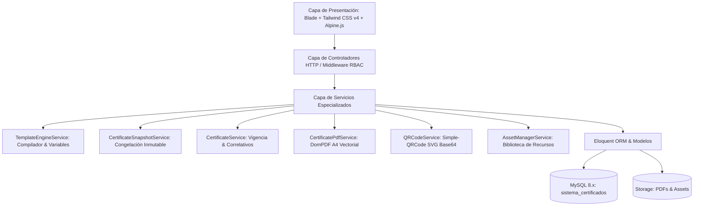
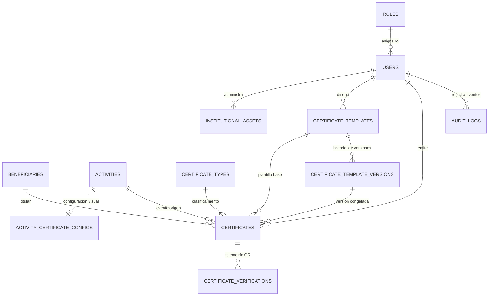
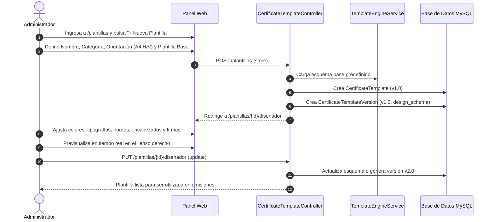
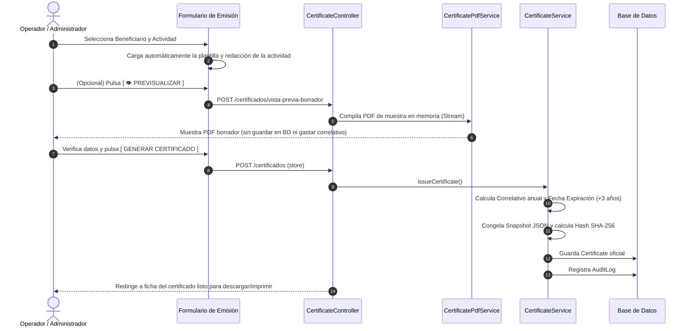
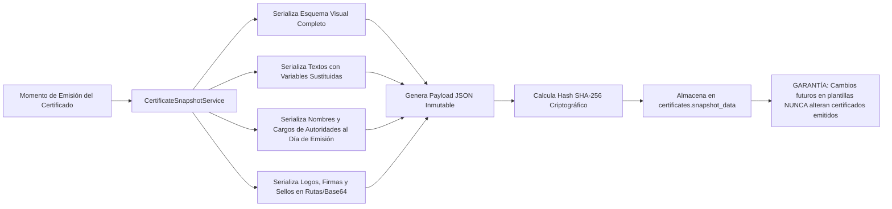

# Plan de Arquitectura y Evolución: Gestor y Diseñador de Certificados Institucionales Personalizables

## 🎯 Descripción del Objetivo

Evolucionar el sistema actual del Vicedecanato de un generador de PDFs con plantillas fijas a una **plataforma completa de diseño, gestión, emisión y verificación de certificados institucionales configurables**, garantizando:
- Identidad universitaria formal (UMSA / Facultad de Ciencias Puras y Naturales / Vicedecanato).
- Diseños diferenciados según la actividad académica, mérito, autoridades y co-organizadores.
- Control visual de colores, tipografías, bordes ornamentales, marcas de agua, sellos, firmas múltiples y códigos QR.
- **Inmutabilidad absoluta** mediante congelación documental (Snapshot JSON + Hash SHA-256): ningún certificado emitido en el pasado podrá alterarse si la plantilla cambia a futuro.
- Funcionamiento verificado sobre **PHP 8.3/8.5** en entorno **Laragon (MySQL 8.x)**.

---

## 🏛️ 1. Arquitectura Actual del Sistema

El sistema implementa una arquitectura en capas basada en **Laravel 13 (MVC)** con una **Capa de Servicios (Service Layer)** para desacoplar la lógica de renderizado gráfico, criptografía y persistencia:



### Componentes de la Arquitectura:
- **Presentación:** Vistas Blade institucionales enriquecidas con Tailwind CSS v4 y Alpine.js para interactividad reactiva en modales, previsualizaciones en vivo e inspectores visuales.
- **Seguridad & RBAC:** Autenticación por sesión protegida con middleware `EnsureUserIsAdmin` para restringir la creación de plantillas, auditoría y biblioteca de recursos exclusivamente a administradores.
- **Capa de Servicios:** Lógica de negocio centralizada bajo `app/Services/` para evitar controladores sobrecargados.
- **Persistencia Transaccional:** MySQL 8.x con 12 migraciones relacionales, claves foráneas, restricciones de unicidad e índices optimizados.

---

## ♻️ 2. Componentes Reutilizables Existentes

Se conserva y potencia el 100% de la infraestructura previa:
1. **Módulo de Autenticación y RBAC (`AuthController`, `User`, `Role`, `EnsureUserIsAdmin`):** Totalmente funcional con roles `admin` y `operator`.
2. **Padrón de Beneficiarios (`BeneficiaryController`, `Beneficiary`):** Registro de participantes con grado académico, cédula única y soporte de Soft Deletes.
3. **Catálogo de Actividades Académicas (`ActivityController`, `Activity`):** Horas académicas, fechas, organizadores y soporte de emisión masiva.
4. **Tipos de Certificado (`CertificateType`):** Catálogo formal de méritos (*Aprobación, Asistencia, Disertante, Organizador, Reconocimiento*).
5. **Servicio QR Vectorial (`QRCodeService`):** Generador SVG con corrección de error 'H' (30%) incrustado en Base64 sin requerir librerías pesadas de imágenes.
6. **Regla de Vigencia de 3 Años (`Certificate`):** Cálculo automático de `expiration_date` y evaluador dinámico de estados (`VIGENTE`, `EXPIRADO`, `REVOCADO`).
7. **Portal Público de Verificación (`VerificationController`):** Ruta `/verificar/{token}` protegida con token UUID v4 y búsqueda manual por código.
8. **Módulos de Auditoría y Reportes (`AuditLogController`, `ReportController`):** Registro de acciones y reportes con filtros imprimibles.

---

## 🔧 3. Componentes que se Modifican y Amplían

1. **`CertificateTemplate` & `CertificateTemplateVersion`:**
   - Dejar de utilizar vistas fijas estáticas para pasar a un **Esquema de Diseño JSON (`design_schema`)**.
   - Soporte de versionado formal (v1, v2, v3) y duplicación en 1 clic.
   - Orientación configurable: A4 Horizontal (*Landscape*) y A4 Vertical (*Portrait*).
2. **`Activity` & `ActivityCertificateConfig`:**
   - Relación 1:1 para que cada actividad pueda tener asignada su propia plantilla, redacción personalizada con tags `{{...}}`, colores del evento, co-firmantes y campos específicos (N° de Resolución Facultativa, Modalidad).
3. **Formulario de Emisión Individual (`certificates.create`):**
   - Incorporación del botón **"[ 👁️ PREVISUALIZAR ]"** para emitir borradores en PDF en tiempo real antes de registrar el documento oficial.
   - Inyección de campos de personalización rápida por certificado (menciones de honor o notas aclaratorias).
4. **Emisión Masiva en Actividades (`ActivityController@batchIssue`):**
   - Adopta la configuración visual de la actividad, garantizando que todos los participantes reciban el diseño específico del evento.
5. **Motor DomPDF (`engine.blade.php`):**
   - Renderizado dinámico de marcos ornamentales (doble línea, filigrana dorada, moderno), marcas de agua con opacidad regulable, distribución adaptativa de 1 a 3 firmas y logos escalados proporcionalmente.

---

## 🗄️ 4. Estructura de Tablas y Base de Datos

Las 12 tablas se encuentran integradas y migradas en MySQL:



### Tablas Principales del Diseñador:
- **`institutional_assets`**: Catálogo de escudos, logos, firmas con cargos, sellos y marcas de agua.
- **`certificate_templates`**: Catálogo maestro de plantillas con `category`, `orientation`, `current_version` e `is_default`.
- **`certificate_template_versions`**: Histórico inmutable de versiones de cada plantilla con su `design_schema` JSON y resumen de cambios.
- **`activity_certificate_configs`**: Configuración particular de certificado por actividad académica.
- **`certificates`**: Almacena el correlativo `CERT-YYYY-XXXXXX`, token UUID v4, vigencia, `template_version_id`, `custom_fields_data` y el **`snapshot_data` JSON 100% inmutable**.

---

## ⚙️ 5. Capa de Servicios Especializados

1. **`TemplateEngineService` (`app/Services/TemplateEngineService.php`):**
   - Compilador del esquema de diseño a estilos y directivas DomPDF.
   - Motor de interpolación de variables dinámicas:
     `{{beneficiario.nombre}}`, `{{beneficiario.documento}}`, `{{actividad.nombre}}`, `{{actividad.horas}}`, `{{actividad.fechas}}`, `{{certificado.codigo}}`, `{{autoridad.nombre}}`, `{{autoridad.cargo}}`, `{{campos.resolucion}}`, etc.
   - Generación de rejilla equilibrada de 1, 2 o 3 firmas institucionales.
   - Repositorio de las 8 plantillas iniciales de referencia.
2. **`CertificateSnapshotService` (`app/Services/CertificateSnapshotService.php`):**
   - Responsable de la **congelación documental absoluta**. Serializa el estado completo del diseño, textos sustituidos, imágenes en Base64 o rutas fijas, sellos y autoridades al momento de la emisión.
3. **`AssetManagerService` (`app/Services/AssetManagerService.php`):**
   - Almacenamiento seguro, tipado y validación de archivos gráficos institucionales (PNG, JPG, SVG, WebP).
4. **`CertificateService` (`app/Services/CertificateService.php`):**
   - Coordinador de emisión, cálculo de 3 años de vigencia, correlativos anuales, hash SHA-256 de integridad y revocaciones.
5. **`CertificatePdfService` (`app/Services/CertificatePdfService.php`):**
   - Compilador DomPDF A4 (Horizontal/Vertical) optimizado para impresión institucional.

---

## 🔄 6. Flujo de Creación de Plantillas



---

## 🎨 7. Flujo de Personalización (Global y por Actividad)

```mermaid
flowchart TD
    A[Administrador abre Actividad Académica] --> B[Sección: Configuración del Certificado para este Evento]
    B --> C[Asigna Plantilla del Catálogo]
    B --> D[Define Título Especial ej. DIPLOMA DE HONOR]
    B --> E[Sobrescribe Colores Primario y Secundario del Evento]
    B --> F[Redacta Cuerpo con Variables: Por su aprobación en {{actividad.nombre}}...]
    B --> G[Agrega Metadatos: N° Resolución Facultativa, Modalidad, Co-organizadores]
    C & D & E & F & G --> H[Guarda en activity_certificate_configs]
    H --> I[Resultado: ACTIVIDAD 1 ≠ ACTIVIDAD 2, conservando identidad institucional]
```

---

## ⚡ 8. Flujo de Emisión (Individual y Masiva con Borrador)



---

## 🧊 9. Flujo de Congelación Documental del Certificado



---

## 📅 10. Plan de Implementación y Fases de Validación

### Fase 1: Arquitectura y Modelado Relacional (Completada y Verificada)
- 12 migraciones relacionales creadas y ejecutadas en MySQL sin errores de identificadores.
- Modelos `InstitutionalAsset`, `CertificateTemplateVersion`, `ActivityCertificateConfig` activos.

### Fase 2: Capa de Servicios y Motor de Diseño (Completada y Verificada)
- `TemplateEngineService` operativo con sustitución de variables dinámicas y las 8 plantillas base.
- `CertificateSnapshotService` operativo con congelación JSON y SHA-256.
- `AssetManagerService` y `QRCodeService` vectoriales activos.

### Fase 3: Diseñador Visual y Biblioteca de Recursos (Completada y Verificada)
- Vistas de catálogo y editor visual `/plantillas` y `/plantillas/{id}/disenador`.
- Biblioteca institucional `/recursos-institucionales` con carga y categorización de recursos.

### Fase 4: Personalización por Actividad y Previsualización de Borradores (Completada y Verificada)
- Integración en `/actividades/{id}` de la configuración personalizada de certificado.
- Botón y modal de previsualización borrador en `/certificados/crear`.

### Fase 5: Suite de Pruebas y Documentación (Completada y Verificada)
- 24 pruebas automatizadas con 77 aserciones aprobadas al 100%.
- Documentación técnica y manual de usuario actualizados a la versión 2.0.0.

---

## ⚠️ User Review Required

> [!IMPORTANT]
> **Compatibilidad de Identificadores en MySQL:**  
> Se formalizó el nombre explícito `'tpl_version_unique'` en el índice único de versiones de plantilla, eliminando el error de 76 caracteres que causaba el fallo en MySQL.

> [!NOTE]
> **Aprobación de Flujos:**  
> Revisa la estructura de los 4 flujos operativos (Creación de Plantillas, Personalización por Actividad, Emisión con Borrador y Congelación Documental) para confirmar tu aprobación y proceder con cualquier ajuste adicional que requieras.

---

## 🧪 Plan de Verificación Técnica

### Pruebas Automatizadas
```powershell
& "C:\laragon\bin\php\php-8.3.28-Win32-vs16-x64\php.exe" vendor/bin/phpunit
```
- **Esperado:** 24 tests pasados, 77 aserciones, 0 errores.

### Pruebas Manuales en Laragon
1. Navegar a `http://localhost:8000/plantillas` y verificar el catálogo de plantillas con orden `is_default desc, name asc`.
2. Abrir el Diseñador Visual (`/plantillas/{id}/disenador`) y probar los cambios de color y previsualización interactiva.
3. Navegar a `http://localhost:8000/recursos-institucionales` y verificar los 7 recursos iniciales.
4. Ingresar a una actividad en `http://localhost:8000/actividades/1` y comprobar el panel de configuración de certificado.
5. Ingresar a `http://localhost:8000/certificados/crear` y pulsar `[ 👁️ PREVISUALIZAR ]`.
